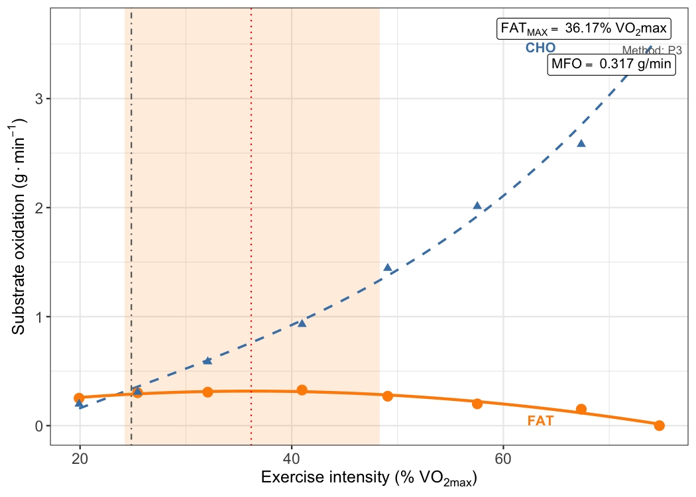
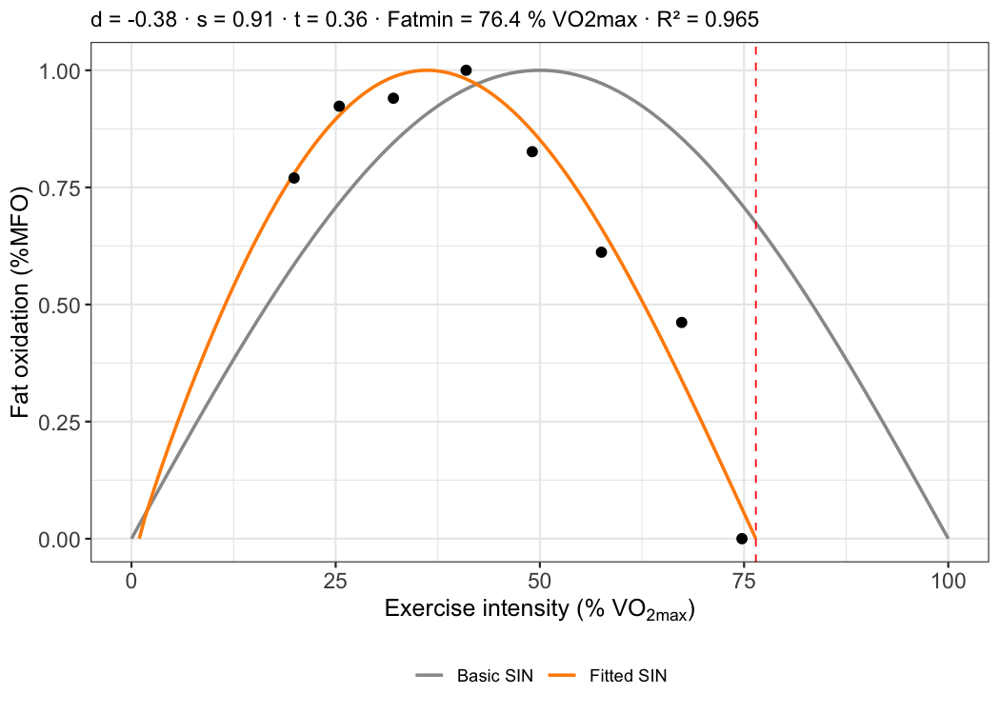

<!-- README.md is generated from README.Rmd. Please edit that file -->

# MFO <!-- omit in toc -->

<!-- badges: start -->

[](https://github.com/JorgeDelro/MFO/actions/workflows/R-CMD-check.yaml)
[](https://app.codecov.io/gh/JorgeDelro/MFO)
[](https://CRAN.R-project.org/package=MFO)
[](https://opensource.org/licenses/MIT)
<!-- badges: end -->

**MFO** computes, from indirect-calorimetry data, the maximal fat
oxidation rate (**MFO**), the exercise intensity at which it occurs
(**Fatmax**), the **Fatmax zone**, the **crossover point**, and the
**SIN model** of fat oxidation kinetics (Chenevière et al., 2009). It is
aimed at sport and health scientists who run graded exercise tests and
want a reproducible, documented alternative to hand-made spreadsheets.

## Installation

The development version (0.2.x, recommended) is installed from GitHub:

``` r
# install.packages("pak")
pak::pak("JorgeDelro/MFO")
```

The CRAN release is still 0.1.0 (2022) and lacks most of the features
described below:

``` r
install.packages("MFO")
```

## What you need

One participant is described by three recordings, exported from the gas
analyser at a fixed sampling interval (`step_time`, in seconds) with
columns `VO2` and `VCO2` (mL/min), `RER` and `HR` (bpm):

| Recording                      | Argument    | Used for                                                            |
|--------------------------------|-------------|---------------------------------------------------------------------|
| Resting metabolism (15–30 min) | `db_basal`  | Most stable 5-min window → resting VO2, RER, CHO, FAT, kcal         |
| Incremental MFO test           | `db_MFO`    | Steady-state average of each step → fat oxidation curve             |
| Maximal graded test            | `db_graded` | VO2max, to express intensity as %VO2max (or pass `VO2max` directly) |

The package ships one anonymised example participant (`basal_df`,
`MFO_df`, `VO2max_df`).

## Example

``` r
library(MFO)

data(list = c("basal_df", "MFO_df", "VO2max_df"), package = "MFO")

result <- MFO(
  step_time = 20,             # one record every 20 s
  db_MFO = MFO_df,
  db_basal = basal_df,
  db_graded = VO2max_df,
  cv_var = "RER",             # stability criterion for the resting window
  author = "Frayn",           # stoichiometric equations
  method = "P3",              # curve-fitting method
  step_duration = 180,        # 3-min steps
  steady_state_duration = 60, # average the last minute of each step
  body_mass = 75,
  HRmax = 190
)
#> Warning in MFO(step_time = 20, db_MFO = MFO_df, db_basal = basal_df, db_graded
#> = VO2max_df, : 1 step(s) with negative fat oxidation detected (RER > 1.0
#> artifact).

result$MFO       # g/min
#> [1] 0.316712
result$FAT_MAX   # %VO2max
#> [1] 34.8358
c(result$FatMax_zone_lower, result$FatMax_zone_upper)
#> [1] 23.29808 46.55705
```

``` r
result$MFO_plot
```



The kinetics of the curve are described with the SIN model:

``` r
kin <- MFO_kinetics(result$MFO_db)
unlist(kin[c("d", "s", "t", "FatMax_SIN", "Fatmin", "R_squared")])
#>          d          s          t FatMax_SIN     Fatmin  R_squared 
#>  0.1704067  0.9348865 -0.1209002 34.6633388 73.2892207  0.9972825
```

``` r
kin$MFO_kinetics_plot
#> Warning: Removed 27 rows containing missing values or values outside the scale range
#> (`geom_line()`).
```



To process a whole folder of participants and write a summary table, see
`?MFOs`.

## Methods

### Substrate oxidation

Fat (FAT) and carbohydrate (CHO) oxidation in g/min are computed from
VO2 and VCO2 in L/min, assuming negligible protein oxidation during
exercise. Choose the equation set with `author`:

| `author`       | CHO (g/min)                                                                      | FAT (g/min)              | Source                       |
|----------------|----------------------------------------------------------------------------------|--------------------------|------------------------------|
| `"Frayn"`      | 4.55 VCO2 − 3.21 VO2                                                             | 1.67 VO2 − 1.67 VCO2     | Frayn (1983)                 |
| `"Peronnet"`   | 4.585 VCO2 − 3.2255 VO2                                                          | 1.6946 VO2 − 1.7012 VCO2 | Péronnet & Massicotte (1991) |
| `"Jeukendrup"` | 4.344 VCO2 − 3.061 VO2 (40–50 %VO2max)<br>4.210 VCO2 − 2.962 VO2 (50–75 %VO2max) | 1.695 VO2 − 1.701 VCO2   | Jeukendrup & Wallis (2005)   |

`"Jeukendrup"` needs VO2max to pick the CHO equation for each step.
Energy expenditure is CHO × 4 + FAT × 9 kcal/min. Always report which
equation you used: differences are small for FAT but grow for CHO and
the crossover point.

### Locating MFO and Fatmax

Each step contributes one point (FAT, %VO2max). `method` chooses how the
maximum is located:

- **`"P3"`** (default): third-degree polynomial
  $\mathrm{FAT}(x) = a + bx + cx^2 + dx^3$, with $x$ = %VO2max. Fatmax
  is the root of $b + 2cx + 3dx^2 = 0$ that lies within the measured
  range and gives the highest FAT. Falls back to P2 with a warning if
  the cubic cannot be fitted.
- **`"P2"`**: parabola, Fatmax $= -b / 2c$. More stable with few steps,
  but forces a symmetric curve.
- **`"MRER"`**: the step with the highest observed
  $\mathrm{FAT} = 1.7\,(1 - \mathrm{RER})\,\mathrm{VO_2}$ (see [Known
  issues](#known-issues-in-v02x)).

For P3 and P2 the fit’s `R_squared` and `RMSE` are returned. The
**Fatmax zone** is the range of intensities where the fitted FAT is ≥ 90
% of MFO (Achten et al., 2002). The **crossover point** is the intensity
at which CHO exceeds FAT, by linear interpolation between steps.

### SIN model

`MFO_kinetics()` normalises fat oxidation to %MFO and fits the
three-parameter sine model of Chenevière et al. (2009, eq. 14) by
non-linear least squares (`minpack.lm::nlsLM`):

$$
\%\mathrm{MFO}(x) = \sin\left\{\left[\frac{\pi^{1/s}}{\pi + 2d}\left(Kx + d + t\right)\right]^{s}\right\},
\qquad K = \frac{\pi}{100}
$$

- **d (dilatation)**: d \> 0 widens the curve, d \< 0 narrows it.
- **s (symmetry)**: s \> 1 shifts the peak to the right with a steeper
  fall; s \< 1 the opposite.
- **t (translation)**: t \> 0 shifts the whole curve to the left.

With d = 0, s = 1 and t = 0 the curve is a half sine wave peaking at 50
%VO2max.

### Test termination and artefacts

At high intensity, lactate buffering pushes RER above 1 and the
equations return negative FAT. Two arguments control this:

- `RER_cutoff`: steps with RER above this value are removed before
  fitting. Use 1.00 (classic), or 0.93 (sedentary) / 0.90 (trained)
  following Amaro-Gahete et al. (2019).
- `negative_FAT`: `"truncate"` negative values to 0 (default),
  `"exclude"` those steps, or `"keep"` them (inspection only).

### Outputs

| Element                                  | Unit            | Meaning                                        |
|------------------------------------------|-----------------|------------------------------------------------|
| `MFO`                                    | g/min           | Maximal fat oxidation                          |
| `MFO_relative`                           | mg/kg/min       | MFO / body mass (if `body_mass` given)         |
| `MFO_FFM`                                | mg/kgFFM/min    | MFO / fat-free mass (if `fat_free_mass` given) |
| `FAT_MAX`                                | %VO2max         | Intensity eliciting MFO                        |
| `FAT_MAX_HR`                             | bpm             | Heart rate at Fatmax (linear interpolation)    |
| `FAT_MAX_porcHRmax`                      | %HRmax          | Fatmax as %HRmax (if `HRmax` given)            |
| `FatMax_zone_lower`, `FatMax_zone_upper` | %VO2max         | Fatmax zone                                    |
| `crossover_point`                        | %VO2max         | Intensity where CHO \> FAT                     |
| `R_squared`, `RMSE`                      | –               | Goodness of fit                                |
| `x_CHO`, `x_FAT`, `x_Kcal`               | g/min, kcal/min | Resting values                                 |
| `MFO_db`, `MFO_plot`                     | –               | Step table and ggplot                          |

## Known issues in v0.2.x

These were found while verifying the code against the primary sources
(see `docs/SPEC.md`, section 19) and are scheduled for v0.2.1. The SIN
and MRER issues do not affect MFO and Fatmax obtained with P3 or P2.

- **SIN model formula.** The code computes $(\pi^{1/s}/\pi) + 2d$
  instead of $\pi^{1/s}/(\pi + 2d)$. Both agree when d = 0, but
  otherwise the returned `d` is **not** comparable with values published
  by Chenevière et al. The fit is also made on a P3-smoothed grid rather
  than on the observed steps, and `Fatmin` uses a 5 % threshold instead
  of the second zero of the curve.
- **`method = "MRER"`** takes the observed maximum of 1.7 (1 − RER) VO2.
  This is a measured-values (MV) method, not the two-regression MRER
  procedure of Chenevière et al. (2009).
- **VO2max** from `db_graded` is the single highest record, not a 30-s
  average, which can overestimate VO2max and shift Fatmax to the left.
- **Resting values** are always computed with Frayn’s equations,
  whatever `author` is, and the resting row is not used in the curve
  fit.
- The `Load` column of `MFO_db` is a step label, not the measured
  external load.

## References

- Achten J, Gleeson M, Jeukendrup AE (2002). Determination of the
  exercise intensity that elicits maximal fat oxidation. *Med Sci Sports
  Exerc* 34:92–97. <https://doi.org/10.1097/00005768-200201000-00015>
- Amaro-Gahete FJ, et al. (2019). Optimizing maximal fat oxidation
  assessment by a treadmill-based graded exercise protocol: when should
  the test end? *Front Physiol* 10:909.
  <https://doi.org/10.3389/fphys.2019.00909>
- Chenevière X, Malatesta D, Peters EM, Borrani F (2009). A mathematical
  model to describe fat oxidation kinetics during graded exercise. *Med
  Sci Sports Exerc* 41:1615–1625.
  <https://doi.org/10.1249/MSS.0b013e31819e2f91>
- Frayn KN (1983). Calculation of substrate oxidation rates in vivo from
  gaseous exchange. *J Appl Physiol* 55:628–634.
- Jeukendrup AE, Wallis GA (2005). Measurement of substrate oxidation
  during exercise by means of gas exchange measurements. *Int J Sports
  Med* 26 Suppl 1:S28–S37.
- Montes-de-Oca-García A, Perez-Bey A, Corral-Pérez J, et al. (2021).
  Maximal fat oxidation capacity is associated with cardiometabolic risk
  factors in healthy young adults. *Eur J Sport Sci* 21:907–917.
  <https://doi.org/10.1080/17461391.2020.1788650>
- Péronnet F, Massicotte D (1991). Table of nonprotein respiratory
  quotient: an update. *Can J Sport Sci* 16:23–29.
