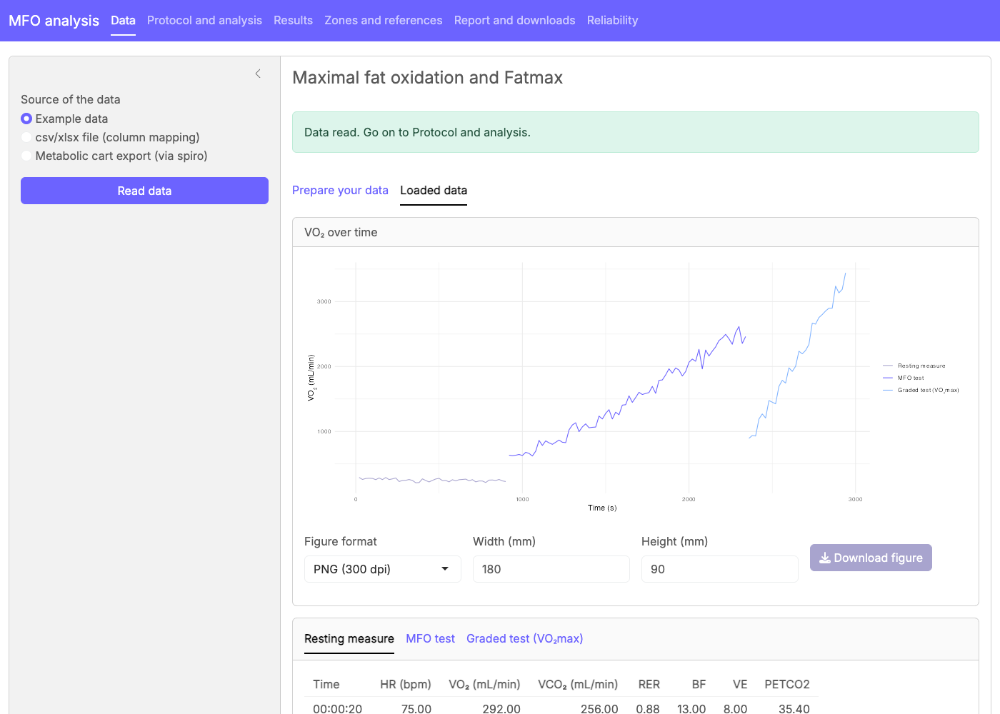
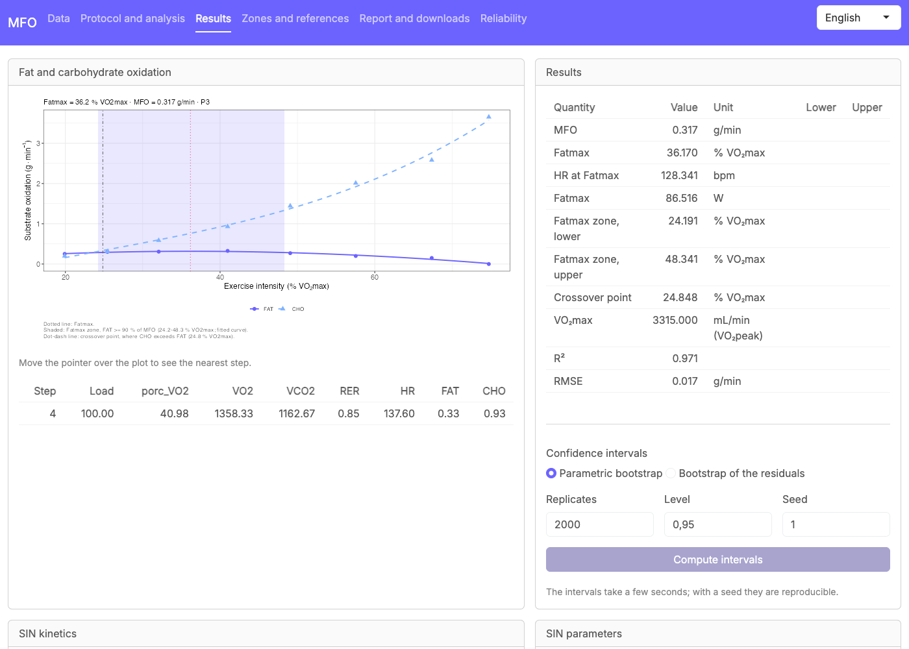
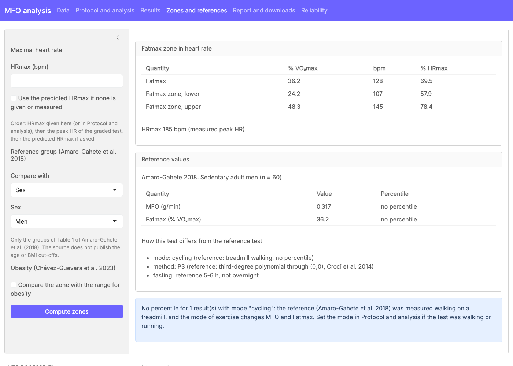

```{r, include = FALSE}
knitr::opts_chunk$set(collapse = TRUE, comment = "#>", eval = FALSE)
```

`run_app()` opens a point-and-click version of the workflow of
`vignette("mfo-workflow")`. The app does no science of its own: every number
comes from `read_cart()`, `MFO()`, `MFO_kinetics()`, `MFO_zones()` and
`MFO_reliability()`, with the same arguments and defaults. The screenshots
show the example data of the package.

This is a short tour. The [app manual](https://jorgedelro.github.io/MFO/articles/app-manual.html)
explains every option, output and warning of each tab.

## Starting the app

The app needs two suggested packages, shiny and bslib:

```{r}
install.packages(c("shiny", "bslib"))
MFO::run_app()
```

The interface is in English.

## Your data stay on your computer

`run_app()` starts the app on your own computer, and the files you upload
are read there; nothing is sent to any server. Keep it that way:

- **Do not deploy the app on a public server with participant data.** The
  0.3.0 release is meant for local use only. A public demonstration, if one
  is ever offered, will work with simulated or example data and without file
  uploads.
- **Use codes, not names.** The group table and the report identify a
  participant only by a code of letters, digits, `_` and `-` (up to 20
  characters); anything else, such as a name or an e-mail address, is
  refused.
- Analyser exports often carry the participant's name in their header lines.
  The app keeps only the columns you map (time, gases, heart rate, load,
  ventilation), never the header.
- The group table lives only in the open session: download it before
  closing the app.

## Tab by tab

### 1. Data

The right side of the tab opens on *Prepare your data*: the three ways to
bring data in (an individual test, a group table built in the app, a
results table for Reliability) and two templates, an xlsx of an individual
test with one sheet per phase and a csv of results. Reading the data
switches to *Loaded data*: the plot of VO₂ against time and, below it, the
tables of each phase.

Choose the source: the example data of the package, a csv/xlsx file with
your own column names, or an export of a metabolic cart read by the spiro
package (Cortex, Cosmed, Vyntus, ZAN). Upload one or several files, or a
zip; every sheet of an xlsx file is a table.

The three phases of the test (resting measure, MFO test and graded test) come
either as one table each, or as one recording that you cut: drag over the
MFO test on the VO₂ plot to set both cuts, then adjust them in the numeric
fields. The cuts are kept in the report and the group table.

The reading options are those of `read_cart()`: records already averaged by
the analyser or breath by breath, the unit of VO₂ (a units row in the file is
taken as its declaration), lines before the header, the decimal mark, and
elapsed or clock time. Every message and warning of the reading is shown.

```{r, echo = FALSE, eval = TRUE, out.width = "100%", fig.alt = "The Data tab after reading the example data: VO2 over time for the resting measure, the MFO test and the graded test, and a table with the records and columns of each phase."}

```

### 2. Protocol and analysis

The arguments of `MFO_protocol()`, `MFO()` and `MFO_kinetics()`: type of
protocol and exercise mode, step durations, load schedule, stoichiometric
equation, energy equivalents, method for Fatmax, RER cutoff, handling of
negative fat oxidation, VO₂max from the graded test or measured elsewhere,
and the participant's age, body mass, fat-free mass and HRmax. The defaults
are those of `MFO()`.

### 3. Results

The fat and carbohydrate curve with MFO, Fatmax, the Fatmax zone and the
crossover point, the steps of the fit under it (downloadable as xlsx or csv,
with porc_VO2 shown as %VO₂max), the table of results, and the SIN kinetics.
Every plot of the app can be downloaded as PNG at 300 dpi, PDF or SVG, 180 mm
wide by default. Confidence intervals are computed
on demand (parametric or residual bootstrap, number of replicates, level and
seed); they are dropped when the analysis is run again.

The quality alerts are the warnings and messages of the run: few steps,
Fatmax at the first or last step, missing heart rate, negative fat
oxidation, a VO₂max window rounded to whole records.

At the bottom, a participant code and a session add the result to the group
table of the session (the columns of `MFOs()`, plus session, analysis date
and phase cuts).

```{r, echo = FALSE, eval = TRUE, out.width = "100%", fig.alt = "The Results tab: fat and carbohydrate oxidation against %VO2max with the Fatmax zone shaded, and the table of results with the controls for confidence intervals."}

```

### 4. Zones and references

`MFO_zones()` on the current result: the Fatmax zone in bpm and % HRmax, and
the source of HRmax (given, measured peak, or predicted only if you ask for
it). With the obesity option and the body fat, the zone is compared with the
range of Chávez-Guevara et al. (2023). MFO and Fatmax are placed among the
percentiles of sedentary adults of Amaro-Gahete et al. (2018), always with
the group and its N, and with a list of the ways in which your test differs
from theirs. That reference was measured walking on a treadmill, so a
cycling test gets no percentile.

```{r, echo = FALSE, eval = TRUE, out.width = "100%", fig.alt = "The Zones and references tab: the Fatmax zone in % VO2max, bpm and % HRmax, and the reference values of sedentary adult men with the list of differences from the reference test."}

```

### 5. Report and downloads

The individual report is a single HTML file, with the plots inside, that
opens in any browser; *Save as PDF* opens the print dialog of the browser
with it. It holds the curve and the
results (with their intervals if computed), the SIN kinetics, the heart-rate
zones and reference values, the quality alerts, a methods paragraph ready to
adapt for a paper, its references, and a footer with the package version and
commit, the dates of the analysis and the report, the data source, the phase
cuts and the seed. The methods paragraph starts with a bracket for you to
complete (hours of fasting and ergometer) and cites only the sources the
package has verified.

The group table can be downloaded as xlsx or csv.

### 6. Reliability

`MFO_reliability()` on the group table of the session, or on one downloaded
earlier, so that sessions analysed on different days can be put together:
two or more sessions per participant, at least 3 participants (30 or more are
recommended). It shows the ICC, SEM, MDC and CV of each outcome, the bias and
limits of agreement of each pair of sessions, and the Bland-Altman plots.
