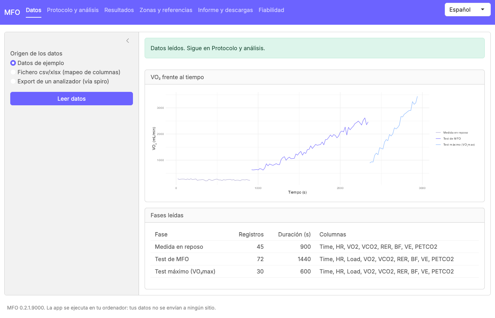
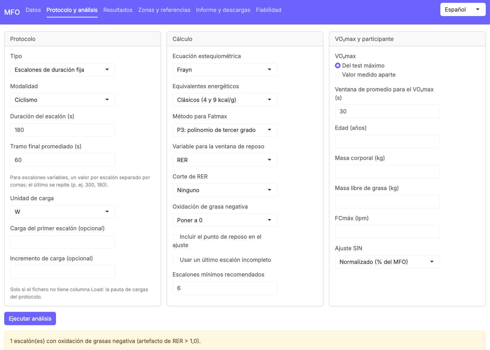
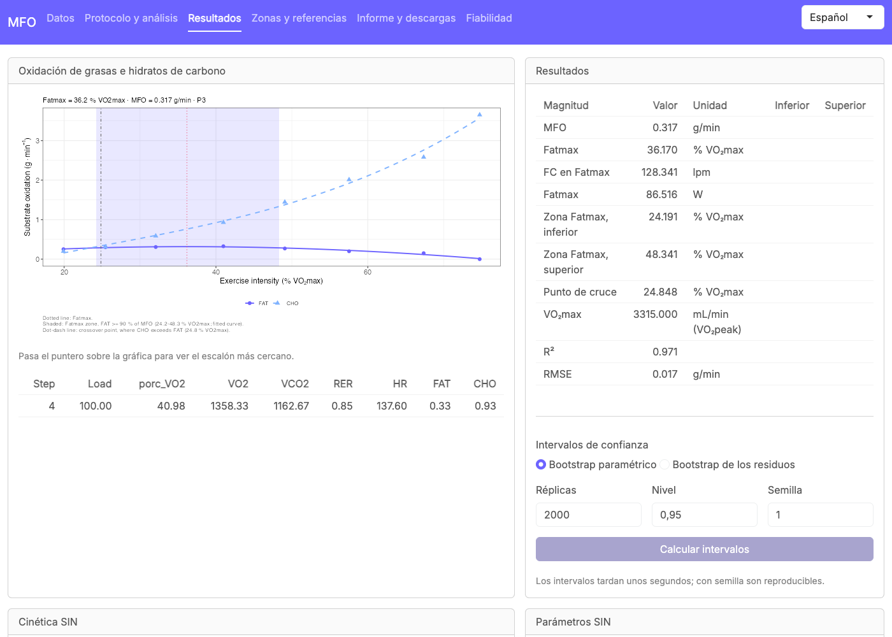
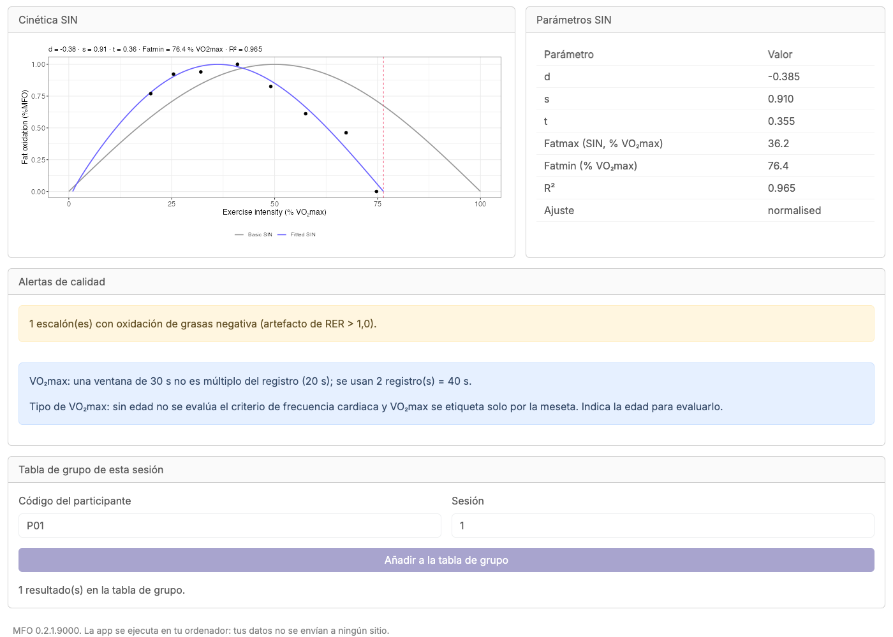
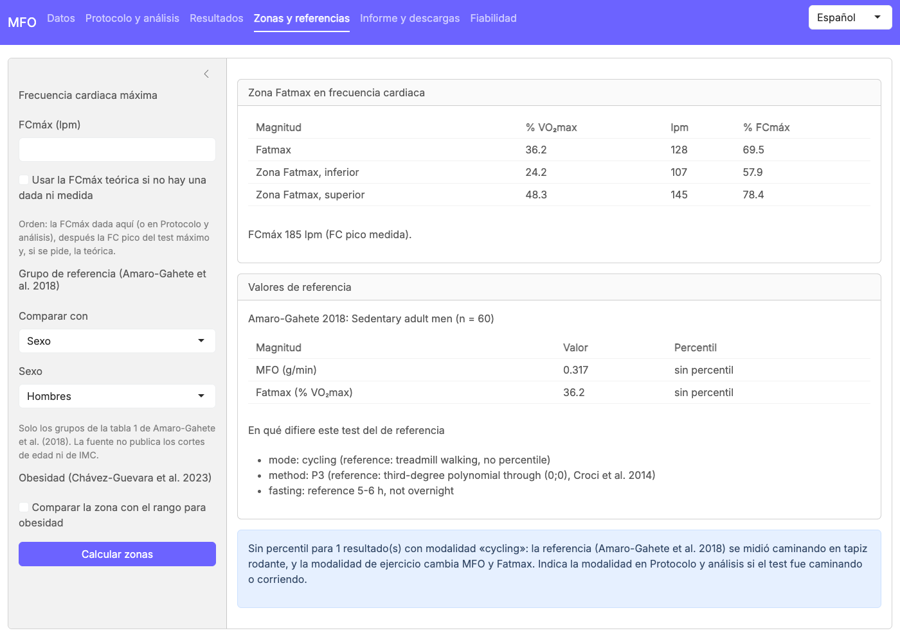
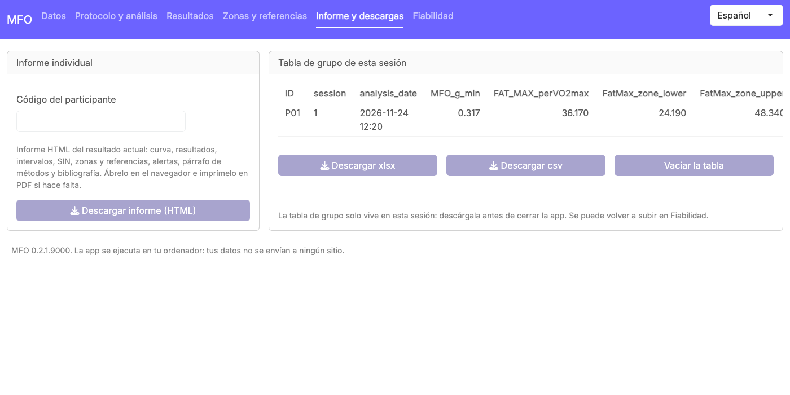
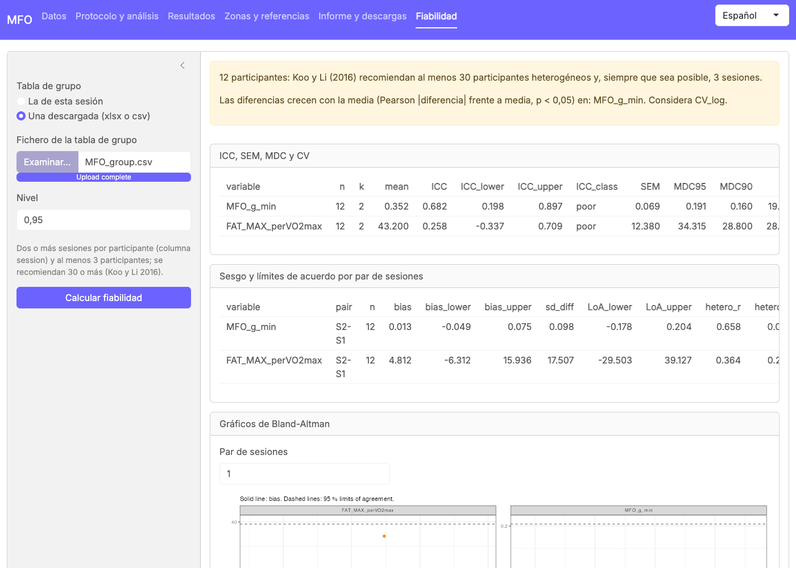

```{r, include = FALSE}
knitr::opts_chunk$set(eval = FALSE)
```

*[English version](app-manual-en.html)*

Este manual describe la app del paquete, `MFO::run_app()`, pestaña a
pestaña: qué hace cada opción y qué implica para el resultado, cómo leer cada
salida y qué significa cada aviso y qué hacer con él. La app no contiene
ciencia propia: cada número sale de una función del paquete (`read_cart()`,
`MFO()`, `MFO_kinetics()`, `MFO_zones()`, `MFO_reliability()`), así que la
ayuda de cada función es la referencia para los detalles. `vignette("app")`
(en inglés) es un recorrido más breve.

Las capturas usan los datos de ejemplo del paquete.

## Antes de empezar

```{r}
install.packages(c("shiny", "bslib"))   # una vez
MFO::run_app("es")    # interfaz en español
MFO::run_app()        # interfaz en inglés
```

- **La app se ejecuta en tu ordenador.** Los ficheros que subes se leen ahí
  y no se envía nada a ningún servidor. La fuente de la interfaz (Inter) se
  descarga la primera vez y se guarda en tu ordenador; si esa primera vez no
  hay red, la app usa la fuente del sistema y lo indica.
- **Idioma.** El selector a la derecha de la barra de navegación cambia el
  idioma en cualquier momento. Los datos leídos, los resultados y la tabla de
  grupo se conservan. Las etiquetas, las tablas y los avisos del paquete
  siguen el idioma; los mensajes de error están en inglés. El informe está
  siempre en inglés, porque está pensado para un artículo.
- **Usa códigos, no nombres.** Los participantes se identifican solo con un
  código de letras, números, `_` y `-` (hasta 20 caracteres). Los ficheros de
  los analizadores suelen llevar el nombre del participante en la cabecera:
  la app solo conserva las columnas que mapeas, nunca la cabecera.
- **Trabaja en orden.** Cada pestaña usa el resultado de la anterior: Datos →
  Protocolo y análisis → Resultados → Zonas y referencias → Informe y
  descargas. Fiabilidad trabaja sobre la tabla de grupo.
- **Un participante cada vez.** La tabla de grupo reúne los resultados de la
  sesión; solo existe mientras la app está abierta, así que descárgala antes
  de cerrarla.

## 1. Datos



### Origen de los datos

| Opción | Qué hace |
|---|---|
| Datos de ejemplo | Las tres tablas del paquete (`basal_df`, `MFO_df`, `VO2max_df`): un participante, registros de 20 s ya promediados por el analizador. Sirve para aprender a usar la app. |
| Fichero csv/xlsx (mapeo de columnas) | Cualquier fichero csv o xlsx. Indicas qué columna es cada variable (*Columnas*). Cada hoja de un xlsx se ofrece como una tabla. |
| Export de un analizador (vía spiro) | Ficheros exportados por Cortex, Cosmed, Vyntus o ZAN, leídos por el paquete spiro (tiene que estar instalado). *Analizador*: *Detectar* deja que spiro reconozca el formato. MFO aún no ha validado un fichero real de cada equipo. |

**Ficheros.** Uno o varios ficheros, o un zip que los contenga. Las tablas
encontradas aparecen en los selectores de fase.

### Fases

El test tiene tres fases: la **medida en reposo**, el **test de MFO** (la
prueba incremental submáxima) y el **test máximo** hasta el agotamiento, que
da el VO₂max.

- **Una tabla por fase.** Elige la tabla de cada fase. El test de MFO es
  obligatorio; la medida en reposo y el test máximo son opcionales (sin test
  máximo, indica el VO₂max en *Protocolo y análisis*).
- **Un registro con cortes.** Las tres fases son un único registro continuo.
  Elígelo y arrastra sobre el test de MFO en la gráfica de VO₂ frente al
  tiempo: el inicio y el final de la selección pasan a ser *Fin de la medida
  en reposo* y *Fin del test de MFO*, que puedes ajustar a mano (segundos
  desde el inicio). Con solo el fin del test de MFO, el registro se divide en
  test de MFO y test máximo (protocolo de un solo día); con solo el fin de la
  medida en reposo, en medida en reposo y test de MFO. Los cortes se
  redondean al límite de registro más cercano (un mensaje lo indica) y quedan
  escritos en el informe y en la tabla de grupo.

### Opciones de lectura

| Opción | Qué hace y qué implica |
|---|---|
| Registros: Ya promediados | Las filas se conservan tal como se exportaron (p. ej. medias de 10 o 20 s del analizador). El intervalo entre filas, que debe ser regular, pasa a ser la duración de registro que usa `MFO()`. |
| Registros: Respiración a respiración | Las respiraciones se promedian en intervalos consecutivos de *Intervalo (s)* (10 por defecto). Cada valor es la media de las respiraciones de ese intervalo, no una interpolación; un intervalo sin respiraciones queda vacío para que los registros sigan alineados en el tiempo. 10 s divide exactamente las duraciones de escalón habituales y las ventanas de 30 s. |
| Unidad de VO₂ | *Automática*: una mediana de VO₂ por encima de 100 se lee como mL/min; con 100 o menos tienes que indicar la unidad, porque L/min y mL/kg/min no se pueden distinguir. Con mL/kg/min, indica la *Masa corporal*. Una fila de unidades en el fichero cuenta como declaración de la unidad. VO₂ y VCO₂ se convierten siempre a mL/min. |
| Líneas antes de la cabecera | (csv/xlsx) Líneas de metadatos que se saltan. |
| Fila de unidades tras la cabecera | (csv/xlsx) La línea siguiente a la cabecera contiene unidades, no datos. |
| Separador decimal | (csv/xlsx) `.` o `,`. |
| Tiempo | (csv/xlsx) Se reconocen segundos, mm:ss, hh:mm:ss y horas de Excel. *Transcurrido desde el inicio* (por defecto): tiempo desde el comienzo del registro (un primer valor por encima de 1 h detiene la lectura con un error que sugiere la otra opción). *Hora del día*: hora de reloj; se resta el primer valor, así que el tiempo cuenta desde el primer registro. |
| Columnas | (csv/xlsx) La columna del fichero para `Time`, `VO2` y `VCO2` (obligatorias) y, si existen, `RER`, `HR`, `Load` y `VE`. Los nombres deben coincidir exactamente. El RER se recalcula siempre como VCO₂/VO₂. |

**Leer datos** lee las tablas con `read_cart()`.

### Salidas

- **VO₂ frente al tiempo**: cada fase en su color. Comprueba que las fases
  están donde esperas y, con cortes, que las líneas discontinuas caen donde
  empieza y termina el test de MFO.
- **Fases leídas**: registros, duración y columnas de cada fase. Una fase más
  corta de lo esperado suele indicar un corte o una tabla equivocados.
- Avisos de la lectura (ver *Avisos y mensajes* más abajo) y un recuadro
  verde cuando los datos están listos.

## 2. Protocolo y análisis



Los argumentos de `MFO_protocol()`, `MFO()` y `MFO_kinetics()`. Los valores
por defecto son los del paquete.

### Protocolo

| Opción | Qué hace y qué implica |
|---|---|
| Tipo | *Escalones de duración fija* (el protocolo habitual); *Escalones de duración variable* (p. ej. un primer escalón más largo: escribe `300, 180`; el último valor se repite); *Escalones en W/kg* (carga relativa a la masa corporal); *Rampa* (rampa continua, promediada en ventanas). |
| Modalidad | Ciclismo, carrera o marcha. No cambia MFO ni Fatmax, pero decide si se aplican los valores de referencia de la pestaña Zonas (se midieron caminando). |
| Duración del escalón (s) | 180 por defecto (3 min). Los escalones se cortan contando registros, así que debe ser múltiplo de la duración de registro. |
| Tramo final promediado (s) | 60 por defecto: se promedian los últimos 60 s de cada escalón, cuando el VO₂ debería haber alcanzado su meseta. |
| Ventana de promedio / Distancia entre ventanas (s) | (Rampa) Cada punto de la curva es la media de una ventana; las ventanas se colocan cada *distancia* segundos. |
| Unidad de carga, Carga del primer escalón, Incremento de carga | Solo si el fichero no tiene columna `Load`: el plan de cargas del protocolo, para dar Fatmax en W o km/h. Con columna `Load` se usa la carga medida. |

### Cálculo

| Opción | Qué hace y qué implica |
|---|---|
| Ecuación estequiométrica | Cómo se calcula la oxidación de grasas e hidratos a partir de VO₂ y VCO₂: Frayn (1983), Péronnet y Massicotte (1991) o Jeukendrup y Wallis (2005). Indícala en el artículo: Frayn y Péronnet difieren en torno a un 1-2 % en grasas, más en hidratos y en el punto de cruce. Jeukendrup y Wallis cubren el 40-75 % VO₂max; los escalones fuera de ese rango se extrapolan, con aviso. |
| Equivalentes energéticos | kcal por gramo para el gasto energético: *Clásicos* (4 y 9 kcal/g) o *Los de la fuente de la ecuación*. MFO y Fatmax (g/min) no dependen de esto. |
| Método para Fatmax | *P3* (por defecto): polinomio de tercer grado ajustado a la oxidación de grasas frente al % VO₂max; Fatmax en su máximo. *P2*: polinomio de segundo grado; su vértice puede caer fuera del rango medido (Fatmax queda entonces extrapolado, con aviso) y es inestable con datos ruidosos. *MV*: el escalón con mayor oxidación de grasas medida; no hay curva, así que su resolución es un escalón y no hay intervalos. *MRER*: rectas de (1 − RER) y de VO₂ frente a la intensidad, Fatmax en el vértice de su producto; se mantiene para comparar con la literatura, no se recomienda como método principal (sobrestimó Fatmax en 3-4 % VO₂max en simulaciones). Si un ajuste falla, el método recurre a otro (P3 → P2 → MV) con aviso, y la tabla de resultados dice qué método se usó. |
| Variable para la ventana de reposo | Los valores en reposo salen de la ventana de 5 min más estable de la medida en reposo; la estabilidad se mide con el coeficiente de variación del RER (por defecto), del VO₂ o del VCO₂. |
| Corte de RER | Los escalones con RER por encima del corte se eliminan antes del ajuste. *Ninguno* (por defecto); *Clásico* 1,00 (Chenevière et al. 2009 promediaron los escalones con RER ≤ 1,00); *Seguro* 0,95, *Sedentarios* 0,93 y *Entrenados* 0,90 (Amaro-Gahete et al. 2019); u otro valor. Un corte bajo deja pocos escalones. |
| Oxidación de grasa negativa | A intensidades altas el RER puede superar 1 y las ecuaciones dan oxidación de grasas negativa (un artefacto). *Poner a 0* (por defecto) mantiene el escalón con 0; *Excluir el escalón* lo quita del ajuste; *Mantener* ajusta el valor negativo. |
| Incluir el punto de reposo en el ajuste | Añade el valor en reposo como escalón 0 de la curva (como Montes de Oca et al. 2021). Cambia los ajustes P3 y P2; desactivado por defecto. |
| Usar un último escalón incompleto | Si el test terminó a mitad de un escalón, ese escalón solo se usa si dura al menos el tramo promediado. Siempre se avisa. |
| Escalones mínimos recomendados | 6 por defecto. Si tras el corte o las exclusiones quedan menos, hay aviso: la curva queda mal determinada. |

### VO₂max y participante

| Opción | Qué hace y qué implica |
|---|---|
| VO₂max: Del test máximo | El VO₂max es la mayor media de VO₂ en la *Ventana de promedio para el VO₂max* (30 s por defecto) de registros consecutivos. Si la ventana no es múltiplo de la duración de registro, se redondea hacia arriba a registros enteros (30 s con registros de 20 s = 40 s), con un mensaje. Se etiqueta como VO₂max o VO₂peak según los criterios de maximalidad; el criterio de frecuencia cardiaca necesita la edad. |
| VO₂max: Valor medido aparte | Indica el VO₂max en mL/min. Se usa tal cual. |
| Edad | Para el criterio de frecuencia cardiaca del VO₂max, y como edad por defecto para la FCmáx teórica en Zonas. |
| Masa corporal, Masa libre de grasa | Dan MFO en mg/kg/min y mg/kg MLG/min. La masa corporal también hace falta para escalones en W/kg. |
| FCmáx | Da Fatmax en % FCmáx. En Zonas tiene prioridad sobre la frecuencia cardiaca pico del test máximo. |
| Ajuste SIN | *Normalizado* (por defecto, como Chenevière et al. 2009): la oxidación de grasas se divide por el escalón más alto antes de ajustar. *Absoluto*: se ajusta en g/min con MFO como cuarto parámetro; menos sesgado en simulaciones, necesita al menos 5 escalones. |

**Ejecutar análisis** ejecuta `MFO()` y `MFO_kinetics()`; los avisos del
análisis aparecen bajo el botón y en Resultados.

## 3. Resultados



### Oxidación de grasas e hidratos de carbono

Los puntos son los escalones (oxidación de grasas e hidratos en g/min) y las
líneas, las curvas ajustadas, frente al % VO₂max. La banda sombreada es la
**zona Fatmax**, las intensidades en las que la oxidación de grasas es al
menos el 90 % del MFO. La línea de puntos es **Fatmax**; la de puntos y
rayas, el **punto de cruce**, donde la oxidación de hidratos supera a la de
grasas. El subtítulo da Fatmax, MFO y el método. **Pasa el puntero sobre la
gráfica** para ver debajo el escalón más cercano (carga, VO₂, VCO₂, RER,
frecuencia cardiaca, grasas e hidratos). Los textos de la gráfica están en
inglés.

Cómo leerla: en un buen test la oxidación de grasas sube, alcanza un máximo
y baja, y Fatmax queda claramente dentro de los escalones medidos. Un máximo
en el primer o el último escalón, una curva plana o pocos puntos dispersos
indican que Fatmax está mal determinado; los avisos lo señalan.

### Tabla de resultados

| Magnitud | Significado |
|---|---|
| MFO | Oxidación máxima de grasas, g/min, en el máximo de la curva (o de los escalones con MV). |
| MFO / masa corporal, MFO / masa libre de grasa | MFO en mg/kg/min y mg/kg MLG/min (si se dieron las masas). |
| Fatmax | La intensidad del MFO, en % VO₂max, en lpm (FC en Fatmax, interpolada entre escalones), en % FCmáx (si se dio la FCmáx) y en unidades de carga (W o km/h). |
| Zona Fatmax, inferior / superior | Límites de la zona en la que la oxidación de grasas es ≥ 90 % del MFO, % VO₂max. |
| Punto de cruce | Intensidad a la que la oxidación de hidratos supera a la de grasas. |
| VO₂max | El valor usado para las intensidades, y si era VO₂max o VO₂peak. |
| R², RMSE | Ajuste de la curva a los escalones (no con MV). |

Los **intervalos de confianza** se calculan a petición: la curva se
reajusta a *Réplicas* (2000 por defecto) tests simulados y el intervalo es el
de percentiles, al *Nivel* indicado (0,95 por defecto). El *Bootstrap
paramétrico* (recomendado) incorpora la incertidumbre de la DE residual, que
importa con 6-10 escalones; el *Bootstrap de los residuos* remuestrea los
residuos y es demasiado estrecho con pocos escalones (cobertura del 88-89 %
para un 95 % nominal en simulaciones). Con una *Semilla* los intervalos son
reproducibles. Expresan la incertidumbre del ajuste dentro de este test, no
el error de un día a otro (ver Fiabilidad), y se descartan al volver a
ejecutar el análisis. No existen para MV.



### Cinética SIN

El modelo SIN de Chenevière et al. (2009) describe la forma de la curva de
oxidación de grasas con tres parámetros: **d** (dilatación, la anchura de la
curva), **s** (simetría: por debajo de 1 la curva se inclina a la izquierda,
por encima de 1 a la derecha) y **t** (traslación a lo largo del eje de
intensidad). La curva gris es el SIN básico (d = s = t = 0) y la de color, el
SIN ajustado; la línea discontinua es **Fatmin**, la intensidad a la que la
oxidación de grasas se hace cero. La tabla da los parámetros, el Fatmax del
SIN, Fatmin y R². Con menos de 4 escalones el SIN no se ajusta; con 4-5 se
ajusta pero no es fiable.

### Alertas de calidad

Los avisos (amarillo) y mensajes (azul) del análisis, en el idioma de la
interfaz. Ver *Avisos y mensajes* más abajo.

### Tabla de grupo de esta sesión

Indica un **código de participante** y una **sesión** y pulsa *Añadir a la
tabla de grupo*. Cada fila lleva las columnas de `MFOs()` más la sesión, la
fecha del análisis y los cortes de fase. Añadir de nuevo el mismo código y
sesión sustituye la fila.

## 4. Zonas y referencias



### Frecuencia cardiaca máxima

La FCmáx que se usa para la zona en % FCmáx es, por este orden: la FCmáx
indicada aquí (por defecto, la de *Protocolo y análisis*); la frecuencia
cardiaca pico del test máximo (la mayor media en la ventana del VO₂max); y,
solo si marcas *Usar la FCmáx teórica*, la FCmáx teórica para la edad:
Tanaka (208 − 0,7 × edad, por defecto) o Fox (220 − edad). El texto bajo la
tabla dice cuál se usó.

### Grupo de referencia (Amaro-Gahete et al. 2018)

**Comparar con** elige uno de los grupos de la tabla 1 de la fuente: la
cohorte completa, el sexo, el grupo de edad (adultos jóvenes, 22,1 ± 2,2
años, o de mediana edad, 52,1 ± 4,6 años), sexo × grupo de edad o el estado
ponderal (normopeso, sobrepeso, obesidad). Solo se publican esas
combinaciones; la fuente no da los cortes de edad ni de IMC, así que el grupo
nunca se deduce de un número.

### Obesidad (Chávez-Guevara et al. 2023)

Con *Comparar la zona con el rango para obesidad* y el porcentaje de grasa,
la zona en % FCmáx se compara con el rango recomendado: 61-66 % FCpico con
más del 35 % de grasa corporal y 57-64 % FCpico con menos del 35 %. El
resultado es *dentro* (toda la zona cae en el rango), *solapa en parte* o
*fuera*. El 35,0 % exacto no lo cubre la fuente, así que no se da rango. El
rango se refiere a la frecuencia cardiaca pico medida: con una FCmáx teórica
la comparación es aproximada (un aviso lo indica).

### Salidas

- **Zona Fatmax en frecuencia cardiaca**: Fatmax y los límites de la zona en
  % VO₂max, lpm y % FCmáx. Usa los valores en lpm para prescribir ejercicio
  con un pulsómetro.
- **Valores de referencia**: el grupo con su tamaño (n), MFO y Fatmax, y su
  percentil entre P20 y P80 (por debajo de P20 o por encima de P80 se indica
  así, sin extrapolar). La referencia se midió **caminando en tapiz rodante**
  tras 5-6 h de ayuno y con su propio método; un test en cicloergómetro no
  recibe percentil, porque la modalidad cambia MFO y Fatmax.
- **En qué difiere este test del de referencia**: modalidad, método y
  ayuno. Lee el percentil teniendo en cuenta estas diferencias (la lista está
  en inglés).

## 5. Informe y descargas



**Informe individual.** Un único fichero HTML, con las gráficas dentro, que
se abre en cualquier navegador y se puede imprimir a PDF. Contiene la curva y
los resultados (con sus intervalos si se calcularon), la cinética SIN, las
zonas de frecuencia cardiaca y los valores de referencia (si se calcularon
para este análisis), las alertas de calidad, un **párrafo de métodos** listo
para adaptar en un artículo, sus referencias y un pie con la versión y el
commit del paquete, las fechas del análisis y del informe, el origen de los
datos, los cortes de fase y la semilla. El párrafo de métodos empieza con un
corchete que completas tú (horas de ayuno y ergómetro) y solo cita fuentes
verificadas por el paquete. El código del participante, si se indica, va en
el título y en el nombre del fichero. El informe está en inglés.

**Tabla de grupo.** Las filas añadidas en Resultados, en xlsx o csv.
*Vaciar la tabla* empieza una nueva. Descárgala antes de cerrar la app: se
puede volver a subir en Fiabilidad.

## 6. Fiabilidad



`MFO_reliability()` sobre la tabla de grupo de esta sesión o sobre una
descargada antes (xlsx o csv), para reunir sesiones analizadas en días
distintos. Necesita dos o más sesiones por participante (columna `session`) y
al menos 3 participantes; se recomiendan 30 o más participantes heterogéneos
y, siempre que sea posible, 3 sesiones (Koo y Li 2016). Para cada variable
solo se usan los participantes con valor en todas las sesiones. Los nombres
de las columnas son los de la función, en inglés.

| Salida | Significado |
|---|---|
| ICC, ICC_lower, ICC_upper | Correlación intraclase ICC(2,1), acuerdo absoluto, con su intervalo. |
| ICC_class | Según el límite inferior del intervalo (Koo y Li 2016): < 0,50 pobre (*poor*), 0,50-0,75 moderada, 0,75-0,90 buena, > 0,90 excelente. |
| SEM | Error estándar de medida, en la unidad de la variable: el error típico de un día a otro. |
| MDC95, MDC90 | Cambio mínimo detectable: un cambio menor que este entre dos tests de una persona puede ser error de medida. |
| CV, CV_log | SEM como porcentaje de la media; CV_log para errores proporcionales al valor. |
| bias, LoA (por par de sesiones) | Diferencia media entre sesiones consecutivas con su intervalo, y límites de acuerdo del 95 % (Bland y Altman 1986). |
| hetero_r, hetero_p | Correlación entre la diferencia absoluta y la media: si es significativa, el error crece con el valor; usa CV_log. |

Los **gráficos de Bland-Altman** muestran, para el par de sesiones elegido,
la diferencia de cada participante frente a su media, con el sesgo (línea
continua) y los límites de acuerdo (discontinuas).

## Avisos y mensajes

Los avisos (amarillo) piden que compruebes algo; los mensajes (azul)
informan. Para cada uno: qué significa y qué hacer.

### Lectura de los datos

| Alerta | Significado y qué hacer |
|---|---|
| El RER exportado difiere de VCO₂/VO₂ en más de 0,02 en n de N intervalos | El RER del analizador no cuadra con sus propios gases (suavizado o promediado distinto). La app usa VCO₂/VO₂. Suele ser inocuo; muchos intervalos pueden indicar un mapeo de columnas equivocado. |
| Cortes redondeados al límite de registro más cercano | Los cortes se movieron al registro más próximo. Comprueba que siguen cayendo donde cambian las fases. |
| Tiempo leído como horas de Excel | La columna de tiempo tenía fracciones de día; se convirtió a segundos. |
| Unidad de VO₂ «…» de la fila de unidades no reconocida | Indica la unidad de VO₂ en las opciones de lectura. |
| Unidad de VO₂ y VCO₂ tomada de la fila de unidades | Información: la fila de unidades declaró la unidad. |

### El análisis

| Alerta | Significado y qué hacer |
|---|---|
| n escalón(es) con oxidación de grasas negativa (artefacto de RER > 1,0) | Suelen ser los últimos escalones. Se tratan según *Oxidación de grasa negativa*. Muchos pueden indicar hiperventilación o un test que fue más allá del rango del MFO. |
| La curva se ajusta con n escalón(es); se recomiendan al menos 6 | Pocos escalones: Fatmax y la zona quedan mal determinados. Revisa el corte de RER y las exclusiones; considera el método MV o un test más largo. |
| Fatmax está en el primer escalón | El máximo queda en el borde del rango medido: puede que el test empezara a una intensidad demasiado alta y el Fatmax real sea menor. |
| Fatmax está en el último escalón | Puede que el test terminara demasiado pronto; el Fatmax real puede ser mayor. |
| P2: el vértice cae fuera del rango medido | Fatmax y MFO están extrapolados. Mejor P3 o MV. |
| El modelo P3 tiene coeficientes ausentes / no tiene puntos críticos reales; se usa P2 | La cúbica no dio un máximo; los resultados salen de P2 (ver el método usado). |
| Los puntos críticos de P3 caen fuera del rango de datos | Se usa el escalón con mayor oxidación de grasas medida. |
| P2 sin máximo / MRER sin máximo o con el vértice fuera del rango; se usa MV | La curva no es cóncava en el rango medido; se usa el máximo medido. |
| Último escalón incompleto (… s de … s): se usa / se descarta | El test terminó a mitad de un escalón. Decide con *Usar un último escalón incompleto*. |
| Las ecuaciones de Jeukendrup y Wallis cubren el 40-75 % VO₂max | Los escalones fuera de ese rango usan el conjunto más cercano de la fuente, extrapolado. |
| Corte de RER: se eliminan n escalón(es) | Información sobre el corte. |
| No hay datos de frecuencia cardiaca / n escalón(es) sin frecuencia cardiaca | Fatmax en lpm no se calcula o se interpola con los escalones que la tienen. MFO y Fatmax no se ven afectados. |
| Protocolo relativo sin masa corporal | Indica la masa corporal para tener la carga en W/kg. |
| VO₂max: la ventana no es múltiplo del registro | La ventana se redondeó hacia arriba a registros enteros. |
| Tipo de VO₂max: sin edad | Indica la edad para que se evalúe el criterio de frecuencia cardiaca del VO₂max. |
| La medida en reposo tiene menos registros de los necesarios / no hay suficientes datos en reposo tras la estabilización | Los valores en reposo salen de todos los datos disponibles; revisa el registro de reposo. |
| Se han dado VO₂max y test máximo / protocolo y duraciones de escalón | Solo se usa el primero. |
| El ajuste recurrió a otro método; no hay intervalo / se descartan n de B réplicas | Intervalos: algunos tests simulados necesitaron otro método y se descartaron; si son muchos, el intervalo no es fiable. |

### Cinética SIN

| Alerta | Significado y qué hacer |
|---|---|
| El modelo SIN necesita al menos 4 escalones | No se ajusta. |
| Modelo SIN ajustado con n escalones: poco fiable | 4-5 escalones: interpreta d, s y t con cautela. |
| El modelo SIN no convergió / convergió a una solución trivial | No hay SIN para este test; suele deberse a pocos escalones o a una oxidación de grasas que solo baja. MFO y Fatmax de la curva no se ven afectados. |

### Zonas y referencias

| Alerta | Significado y qué hacer |
|---|---|
| Sin FCmáx dada, medida ni teórica | La zona se da solo en lpm. Indica la FCmáx, usa un test máximo con frecuencia cardiaca o marca la FCmáx teórica con la edad. |
| Se dio o se midió una FCmáx; tiene prioridad sobre la teórica | Información. |
| Sin percentil con modalidad «cycling» | La referencia se midió caminando; indica la modalidad en *Protocolo y análisis* si el test fue caminando o corriendo. |
| El 35,0 % de grasa no está cubierto | La fuente define más y menos del 35 %; no hay rango. |
| El rango de obesidad se refiere a la FC pico medida | Con una FCmáx teórica la comparación es aproximada. |

### Fiabilidad

| Alerta | Significado y qué hacer |
|---|---|
| n participantes: se recomiendan al menos 30 | Con pocos participantes las estimaciones son imprecisas. |
| Se excluyen n participante(s) sin valor en todas las sesiones | Para esa variable solo se usan los participantes completos. |
| Menos de 3 participantes completos; no se analiza | Esa variable tiene muy pocos datos. |
| Las diferencias crecen con la media | Usa CV_log en lugar de SEM y CV. |
