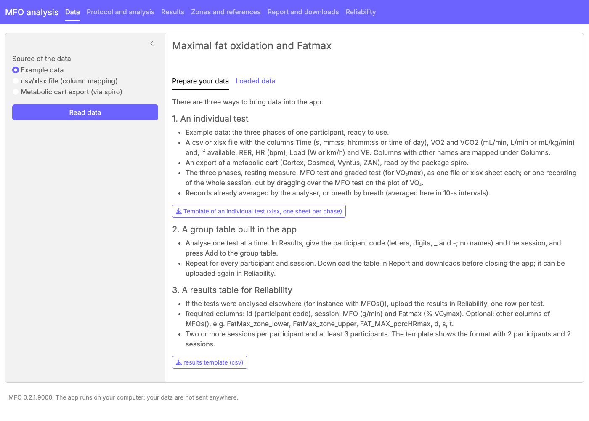
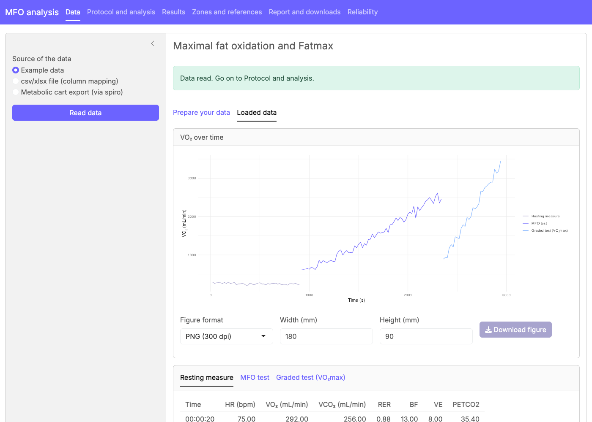
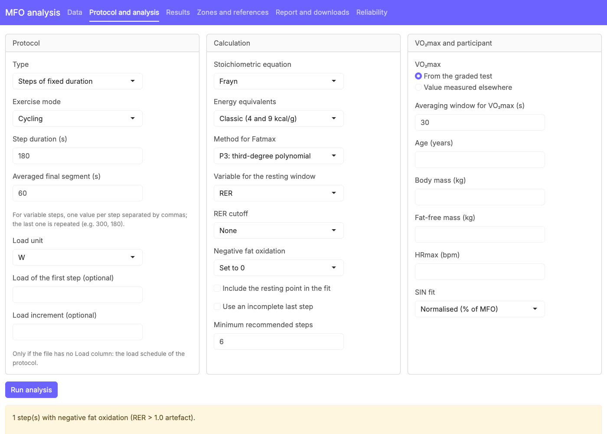
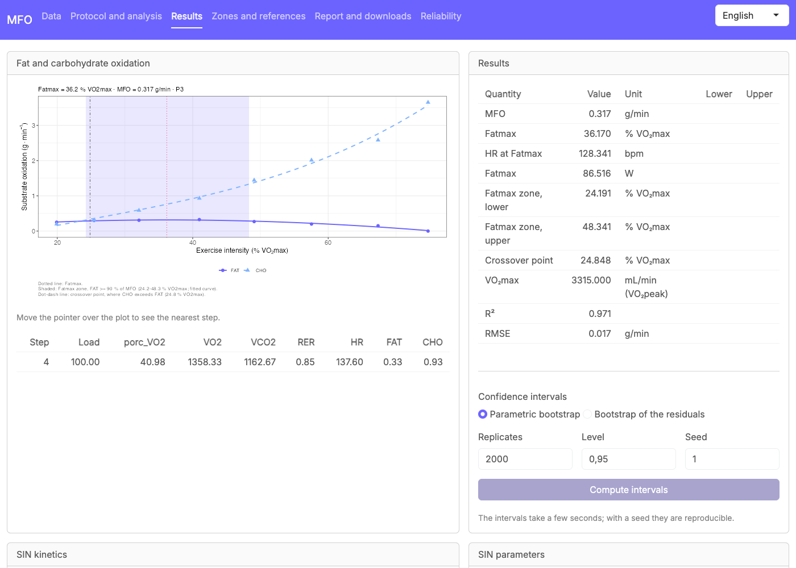
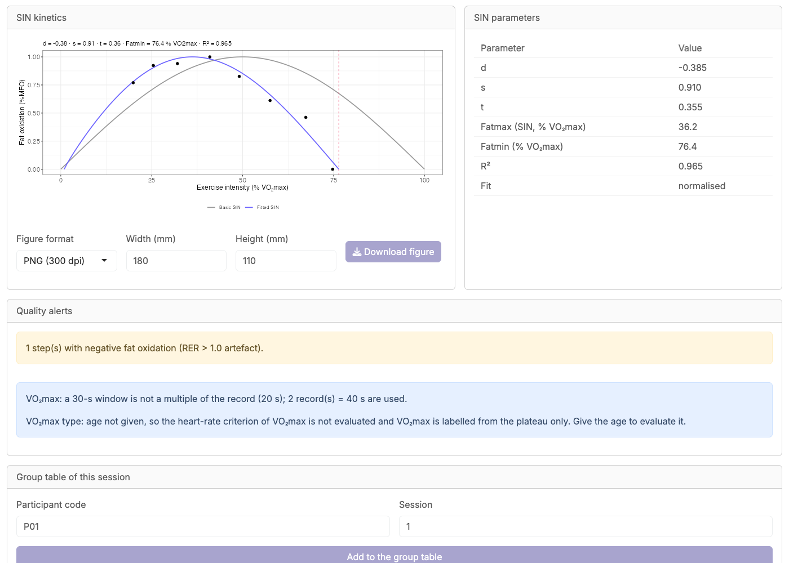
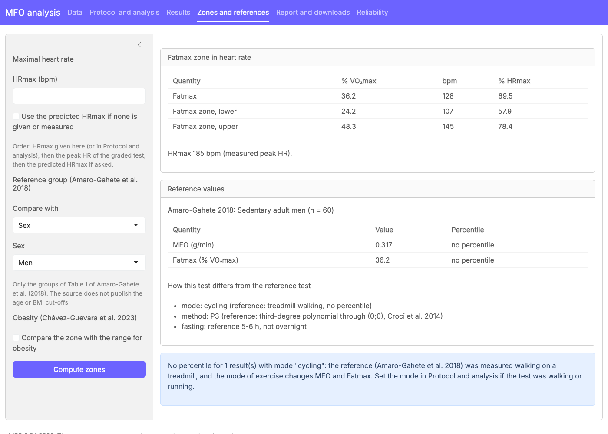
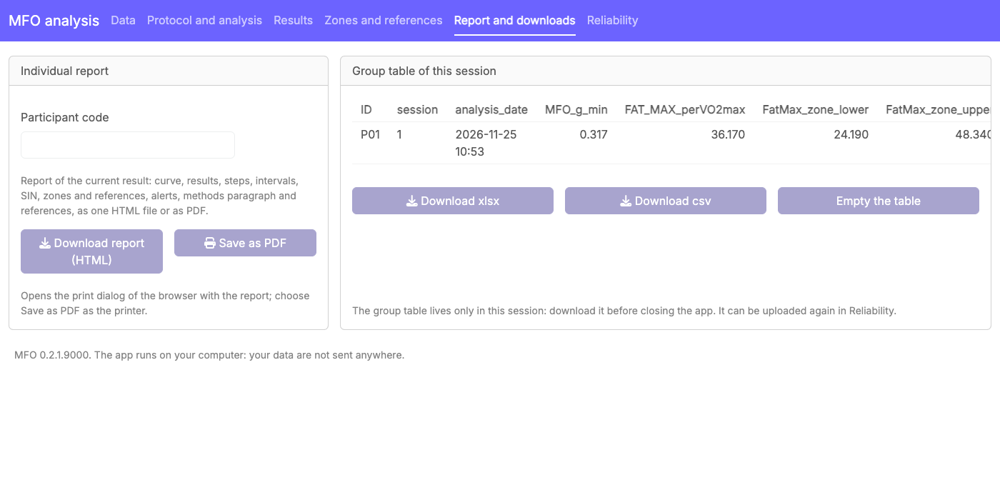
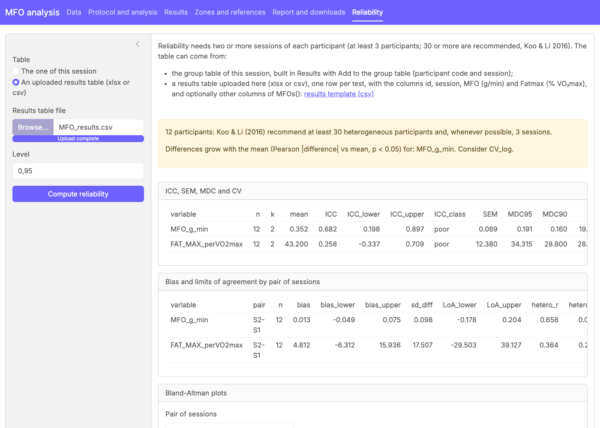

```{r, include = FALSE}
knitr::opts_chunk$set(eval = FALSE)
```

This manual describes the app of the package, `MFO::run_app()`, tab by tab:
what each option does and what it implies for the result, how to read every
output, and what every warning means and what to do about it. The app does
not contain its own science: every number comes from a function of the
package (`read_cart()`, `MFO()`, `MFO_kinetics()`, `MFO_zones()`,
`MFO_reliability()`), so the help page of each function is the reference for
the details. `vignette("app")` gives a shorter tour.

The screenshots use the example data of the package.

## Before you start

```{r}
install.packages(c("shiny", "bslib"))   # once
MFO::run_app()
```

- **The app runs on your computer.** The files you upload are read there and
  nothing is sent to any server. The font of the interface (Inter) is
  downloaded the first time and kept on your computer; without network on
  that first run, the app uses the system font and says so.
- **Use codes, not names.** Participants are identified only by a code of
  letters, digits, `_` and `-` (up to 20 characters). Analyser exports often
  carry the participant's name in their header lines: the app keeps only the
  columns you map, never the header.
- **Work in order.** Each tab uses the result of the previous one: Data →
  Protocol and analysis → Results → Zones and references → Report and
  downloads. Reliability works on the group table.
- **One participant at a time.** The group table collects the results of the
  session; it lives only while the app is open, so download it before closing.

## 1. Data

The left side holds the options; the right side has two tabs, **Prepare
your data**, shown when the app opens, and **Loaded data**, selected when the
data are read.



### Prepare your data

The three ways to bring data into the app:

1. **An individual test**: the example data, a csv or xlsx file, or an
   export of a metabolic cart, with the three phases as one table each or
   as one recording to cut (details below). *Template of an individual test*
   downloads an xlsx with one sheet per phase (Rest, MFO, Graded) and the
   columns `Time` (s), `VO2` and `VCO2` (mL/min), `RER`, `HR` and `Load`
   (W): with these names no column mapping is needed. Choose *csv/xlsx file*,
   upload it and assign one sheet to each phase.
2. **A group table built in the app**: analyse one test at a time and, in
   Results, add each one to the group table with a participant code and a
   session. Download the table in *Report and downloads*; it can be uploaded
   again in Reliability.
3. **A results table for Reliability**, when the tests were analysed
   elsewhere (for instance with `MFOs()`): one row per test with the
   required columns `id` (participant code), `session`, `MFO` (g/min) and
   `Fatmax` (% VO₂max); any other column of `MFOs()` (e.g.
   `FatMax_zone_lower`, `FatMax_zone_upper`, `FAT_MAX_porcHRmax`, `d`, `s`,
   `t`) is optional and analysed too. *Results template* downloads a csv
   with 2 participants × 2 sessions of simulated tests (made with
   `simulate_MFO_sessions()`, written with `write_MFO_sessions()` and
   analysed with `MFOs()`), to show the format.



### Source of the data

| Option | What it does |
|---|---|
| Example data | The three tables of the package (`basal_df`, `MFO_df`, `VO2max_df`): one participant, 20-s records already averaged by the analyser. Use it to learn the app. |
| csv/xlsx file (column mapping) | Any csv or xlsx file. You say which column is each variable (*Columns*). Every sheet of an xlsx is offered as a table. |
| Metabolic cart export (via spiro) | Exports of Cortex, Cosmed, Vyntus or ZAN, read by the package spiro (it must be installed). *Analyser*: *Detect* lets spiro recognise the format. No real export of each device has been validated by MFO yet. |

**Files.** One or several files, or a zip with them. The tables found are
listed in the phase selectors.

### Phases

The test has three phases: the **resting measure**, the **MFO test** (the
submaximal graded test) and the **graded test** to exhaustion that gives
VO₂max.

- **One table per phase.** Choose the table of each phase. The MFO test is
  required; the resting measure and the graded test are optional (without a
  graded test, give VO₂max in *Protocol and analysis*).
- **One recording with cuts.** The three phases are one continuous
  recording. Choose it, then drag over the MFO test on the plot of VO₂ against
  time: the start and the end of the selection become *End of the resting
  measure* and *End of the MFO test*, which you can adjust by hand (seconds
  from the start). With only the end of the MFO test, the recording is split
  into MFO test and graded test (a single-day protocol); with only the end of
  the resting measure, into resting measure and MFO test. The cuts are
  rounded to the nearest record boundary (a message says so) and are written
  in the report and in the group table.

### Reading options

| Option | What it does and implies |
|---|---|
| Records: Already averaged | The rows are kept as exported (e.g. 10-s or 20-s averages of the analyser). The interval between rows, which must be regular, becomes the record length used by `MFO()`. |
| Records: Breath by breath | The breaths are averaged in consecutive intervals of *Interval (s)* (default 10). Each value is the mean of the breaths in that interval, not an interpolation; an interval without breaths stays empty so that the records stay aligned in time. 10 s divides the usual step durations and the 30-s windows exactly. |
| VO₂ unit | *Automatic*: a median VO₂ above 100 is read as mL/min; at or below 100 you must give the unit, because L/min and mL/kg/min cannot be told apart. With mL/kg/min, give the *Body mass*. A units row in the file counts as the declaration of the unit. VO₂ and VCO₂ are always converted to mL/min. |
| Lines before the header | (csv/xlsx) Metadata lines to skip. |
| Units row after the header | (csv/xlsx) The line after the header holds units, not data. |
| Decimal mark | (csv/xlsx) `.` or `,`. |
| Time | (csv/xlsx) Seconds, mm:ss, hh:mm:ss or Excel times are recognised. *Elapsed from the start* (default): time since the start of the recording (a first value above 1 h stops with an error suggesting the other option). *Time of day*: clock time; the first value is subtracted, so time counts from the first record. |
| Columns | (csv/xlsx) The column of the file for `Time`, `VO2` and `VCO2` (required) and, if present, `RER`, `HR`, `Load` and `VE`. Names must match exactly. RER is always recomputed as VCO₂/VO₂. |

**Read data** reads the tables with `read_cart()`.

### Loaded data

- **VO₂ over time**, at full width: each phase in its colour. Check that the
  phases are where you expect and, with cuts, that the dashed lines fall
  where the MFO test starts and ends. In cuts mode this tab opens as soon as
  the recording is chosen, so the cuts can be dragged on the plot.
- Below it, **the tables of each phase** as read (one tab per phase,
  scrolling), before any analysis. Check the units and
  that the values look like those of the analyser; in cuts mode they show
  the whole recording before it is cut.
- **Phases read**: records, duration and columns of each phase. A phase
  shorter than expected usually means a wrong cut or a wrong table.
- Alerts of the reading (see *Warnings and messages* below), then a green
  box when the data are ready.

**Downloading a figure.** Under every plot of the app (VO₂ over time, the
oxidation curve, the SIN kinetics and the Bland-Altman plots) choose the
*Figure format* (PNG at 300 dpi, PDF or SVG), the *Width* (default 180 mm, the
full width of a journal page) and the *Height* in mm, and press *Download
figure*. The figure has the colours of the app. PDF and SVG are vector
formats, best for journals; PNG at 300 dpi for slides and documents.

## 2. Protocol and analysis



The arguments of `MFO_protocol()`, `MFO()` and `MFO_kinetics()`. The defaults
are those of the package.

### Protocol

| Option | What it does and implies |
|---|---|
| Type | *Steps of fixed duration* (the usual protocol); *Steps of variable duration* (e.g. a longer first step: type `300, 180`; the last value is repeated); *Steps in W/kg* (load relative to body mass); *Ramp* (a continuous ramp, averaged in windows). |
| Exercise mode | Cycling, running or walking. It does not change MFO or Fatmax, but it decides whether the reference values of the Zones tab apply (they were measured walking). |
| Step duration (s) | Default 180 (3 min). Steps are cut by counting records, so it should be a multiple of the record length. |
| Averaged final segment (s) | Default 60: the last 60 s of each step are averaged, when VO₂ should have reached its plateau. |
| Averaging window / Distance between windows (s) | (Ramp) Each point of the curve is the mean of a window; windows are placed every *distance* seconds. |
| Load unit, Load of the first step, Load increment | Only if the file has no `Load` column: the load schedule of the protocol, used to give Fatmax in W or km/h. With a `Load` column the measured load is used. |

### Calculation

| Option | What it does and implies |
|---|---|
| Stoichiometric equation | How fat and carbohydrate oxidation are computed from VO₂ and VCO₂: Frayn (1983), Péronnet & Massicotte (1991) or Jeukendrup & Wallis (2005). Report it: Frayn and Péronnet differ by about 1-2 % in fat oxidation, more in carbohydrate and in the crossover point. Jeukendrup & Wallis cover 40-75 % VO₂max; steps outside that range are extrapolated, with a warning. |
| Energy equivalents | kcal per gram for the energy expenditure: *Classic* (4 and 9 kcal/g) or *Those of the equation's source*. MFO and Fatmax (g/min) do not depend on it. |
| Method for Fatmax | *P3* (default): third-degree polynomial fitted to fat oxidation against % VO₂max; Fatmax at its maximum. *P2*: second-degree polynomial; its vertex can fall outside the measured range (then Fatmax is extrapolated, with a warning) and it is unstable with noisy data. *MV*: the step with the highest measured fat oxidation; no curve, so its resolution is one step and there are no intervals. *MRER*: straight lines of (1 − RER) and VO₂ against intensity, Fatmax at the vertex of their product; kept for comparison with the literature, not recommended as the main method (it overestimated Fatmax by 3-4 % VO₂max in simulations). If a fit fails, the method falls back (P3 → P2 → MV) with a warning, and the results table says which method was used. |
| Variable for the resting window | The resting values come from the most stable 5-min window of the resting measure; stability is measured with the coefficient of variation of RER (default), VO₂ or VCO₂. |
| RER cutoff | Steps with RER above the cutoff are removed before the fit. *None* (default); *Classic* 1.00 (Chenevière et al. 2009 averaged steps with RER ≤ 1.00); *Safe* 0.95, *Sedentary* 0.93 and *Trained* 0.90 (Amaro-Gahete et al. 2019); or another value. A low cutoff leaves few steps. |
| Negative fat oxidation | At high intensity RER can exceed 1 and the equations give negative fat oxidation (an artefact). *Set to 0* (default) keeps the step at 0; *Exclude the step* removes it from the fit; *Keep* fits the negative value. |
| Include the resting point in the fit | Adds the resting value as step 0 of the curve (as in Montes de Oca et al. 2021). It changes the P3 and P2 fits; off by default. |
| Use an incomplete last step | If the test ended in the middle of a step, that step is used only if it lasts at least the averaged segment. It is always reported in a warning. |
| Minimum recommended steps | Default 6. Fewer steps left after the cutoff or the exclusions give a warning: the curve is then poorly determined. |

### VO₂max and participant

| Option | What it does and implies |
|---|---|
| VO₂max: From the graded test | VO₂max is the highest mean VO₂ over *Averaging window for VO₂max* (default 30 s) of consecutive records. If the window is not a multiple of the record length, it is rounded up to whole records (30 s with 20-s records = 40 s), with a message. It is labelled VO₂max or VO₂peak from the maximality criteria; the heart-rate criterion needs the age. |
| VO₂max: Value measured elsewhere | Give VO₂max in mL/min. It is used as is. |
| Age | For the heart-rate criterion of VO₂max, and as the default age for the predicted HRmax in Zones. |
| Body mass, Fat-free mass | Give MFO in mg/kg/min and mg/kg FFM/min. Body mass is also needed for steps in W/kg. |
| HRmax | Gives Fatmax as % HRmax. In Zones it takes precedence over the peak heart rate of the graded test. |
| SIN fit | *Normalised* (default, as Chenevière et al. 2009): fat oxidation divided by the highest step before fitting. *Absolute*: fitted in g/min with MFO as a fourth parameter; less biased in simulations, needs at least 5 steps. |

**Run analysis** runs `MFO()` and `MFO_kinetics()`; the alerts of the run
appear below the button and in Results.

## 3. Results



### Fat and carbohydrate oxidation

The points are the steps (fat and carbohydrate oxidation in g/min) and the
lines the fitted curves, against % VO₂max. The shaded band is the **Fatmax
zone**, the intensities where fat oxidation is at least 90 % of MFO. The
dotted line is **Fatmax**; the dot-dash line, the **crossover point**, where
carbohydrate oxidation exceeds fat oxidation. The subtitle gives Fatmax, MFO
and the method. The figure can be downloaded (see *Downloading a figure* in
Data).

Under the plot, always, the **steps of the fit**: for each step, its number,
load, intensity (%VO₂max), VO₂, VCO₂, RER, heart rate, fat and carbohydrate
oxidation and energy expenditure. These are the points of the plot. The
table can be downloaded as xlsx or csv; it is also in the report.

How to read it: a good test shows fat oxidation rising, peaking and falling,
with Fatmax well inside the measured steps. A maximum on the first or last
step, a flat curve or a few scattered points mean that Fatmax is poorly
determined; the alerts say so.

### Results table

| Quantity | Meaning |
|---|---|
| MFO | Maximal fat oxidation, g/min, at the maximum of the curve (or of the steps with MV). |
| MFO / body mass, MFO / fat-free mass | MFO in mg/kg/min and mg/kg FFM/min (if the masses were given). |
| Fatmax | The intensity of MFO, in % VO₂max, in bpm (heart rate at Fatmax, interpolated between steps), in % HRmax (if HRmax was given) and in load units (W or km/h). |
| Fatmax zone, lower / upper | Limits of the zone where fat oxidation ≥ 90 % of MFO, % VO₂max. |
| Crossover point | Intensity where carbohydrate oxidation exceeds fat oxidation. |
| VO₂max | The value used for the intensities, and whether it was VO₂max or VO₂peak. |
| R², RMSE | Fit of the curve to the steps (not for MV). |

**Confidence intervals** are computed on demand: the curve is refitted to
*Replicates* (default 2000) simulated tests and the interval is the
percentile one, at *Level* (default 0.95). *Parametric bootstrap*
(recommended) carries the uncertainty of the residual SD, which matters with
6-10 steps; *Bootstrap of the residuals* resamples the residuals and is too
narrow with few steps (88-89 % coverage for a nominal 95 % in simulations).
With a *Seed* the intervals are reproducible. They give the uncertainty of
the fit within this test, not the day-to-day error (see Reliability), and
they are dropped when the analysis is run again. They are not available for
MV.



### SIN kinetics

The SIN model of Chenevière et al. (2009) describes the shape of the fat
oxidation curve with three parameters: **d** (dilatation, the width of the
curve), **s** (symmetry: below 1 the curve leans to the left, above 1 to the
right) and **t** (translation along the intensity axis). The grey curve is
the basic SIN (d = s = t = 0) and the coloured one the fitted SIN; the dashed
line is **Fatmin**, the intensity at which fat oxidation becomes zero. The
table gives the parameters, Fatmax of the SIN, Fatmin and R². With fewer than
4 steps the SIN is not fitted; with 4-5 steps it is fitted but unreliable.

### Quality alerts

The warnings (yellow) and messages (blue) of the run. See *Warnings and messages* below for each one.

### Group table of this session

Give a **participant code** and a **session** and press *Add to the group
table*. Each row has the columns of `MFOs()` plus the session, the date of
the analysis and the phase cuts. Adding the same code and session again
replaces the row.

## 4. Zones and references



### Maximal heart rate

The HRmax used for the zone in % HRmax is, in this order: the HRmax given
here (by default the one of *Protocol and analysis*); the peak heart rate of
the graded test (the highest mean over the VO₂max window); and, only if you
tick *Use the predicted HRmax*, the predicted HRmax for the age: Tanaka
(208 − 0.7 × age, default) or Fox (220 − age). The text below the table says
which one was used.

### Reference group (Amaro-Gahete et al. 2018)

**Compare with** chooses one of the groups of Table 1 of the source: the
whole cohort, sex, age group (young adults, 22.1 ± 2.2 years, or middle-aged
adults, 52.1 ± 4.6 years), sex × age group, or weight status (normal weight,
overweight, obese). Only those combinations are published; the source does
not give the age or BMI cut-offs, so the group is never deduced from a number.

### Obesity (Chávez-Guevara et al. 2023)

With *Compare the zone with the range for obesity* and the body fat, the
zone in % HRmax is compared with the recommended range: 61-66 % HRpeak with
more than 35 % body fat, 57-64 % HRpeak with less than 35 %. The result is
*inside* (the whole zone is in the range), *partly overlaps* or *outside*.
Exactly 35.0 % is not covered by the source, so no range is given. The range
refers to the measured peak heart rate: with a predicted HRmax the comparison
is approximate (a warning says so).

### Outputs

- **Fatmax zone in heart rate**: Fatmax and the zone limits in % VO₂max, bpm
  and % HRmax. Use the bpm values to prescribe exercise with a heart-rate
  monitor.
- **Reference values**: the group with its size (n), MFO and Fatmax, and
  their percentile between P20 and P80 (below P20 or above P80 it is given as
  such, without extrapolation). The reference was measured **walking on a
  treadmill** after 5-6 h of fasting with its own method; a cycling test gets
  no percentile, because the exercise mode changes MFO and Fatmax.
- **How this test differs from the reference test**: mode, method and
  fasting. Read the percentile with these differences in mind.

## 5. Report and downloads



**Individual report.** *Download report (HTML)* saves one HTML file, with
the plots inside, that opens in any browser. *Save as PDF* opens the print
dialog of the browser with the report: choose *Save as PDF* as the printer
(the downloaded HTML has the same button). It holds the curve, the results
(with their intervals if computed), the steps of the fit, the SIN kinetics, the heart-rate zones
and reference values (if computed for this analysis), the quality alerts, a
**methods paragraph** ready to adapt for a paper, its references, and a
footer with the package version and commit, the dates of the analysis and of
the report, the data source, the phase cuts and the seed. The methods
paragraph opens with a bracket that you complete (hours of fasting and
ergometer) and cites only sources verified by the package. The participant
code, if given, goes in the title and the file name.

**Group table.** The rows added in Results, as xlsx or csv. *Empty the table*
starts a new one. Download it before closing the app: it can be uploaded
again in Reliability.

## 6. Reliability



`MFO_reliability()` on one of two tables, chosen under *Table*:

- **The one of this session**: the group table built in Results with *Add to
  the group table*.
- **An uploaded results table** (xlsx or csv), one row per test, with the
  required columns `id`, `session`, `MFO` (g/min) and `Fatmax` (% VO₂max),
  and optionally other columns of `MFOs()`, each analysed as an outcome. A
  group table downloaded from the app also works (its columns `ID`,
  `MFO_g_min` and `FAT_MAX_perVO2max` are recognised). The text on top of the
  tab links to the results template.

It needs two or more sessions per participant and at least 3 participants; 30 or more heterogeneous participants
and, whenever possible, 3 sessions are recommended (Koo & Li 2016). Only the
participants with a value in every session are used for each outcome.

| Output | Meaning |
|---|---|
| ICC, ICC_lower, ICC_upper | Intraclass correlation ICC(2,1), absolute agreement, with its interval. |
| ICC_class | From the lower bound of the interval (Koo & Li 2016): < 0.50 poor, 0.50-0.75 moderate, 0.75-0.90 good, > 0.90 excellent. |
| SEM | Standard error of measurement, in the unit of the outcome: the typical day-to-day error. |
| MDC95, MDC90 | Minimal detectable change: a change smaller than this between two tests of one person can be measurement error. |
| CV, CV_log | SEM as a percentage of the mean; CV_log for errors proportional to the value. |
| Bias, LoA (by pair of sessions) | Mean difference between consecutive sessions with its interval, and the 95 % limits of agreement (Bland & Altman 1986). |
| hetero_r, hetero_p | Correlation between the absolute difference and the mean: if significant, the error grows with the value; use CV_log. |

The **Bland-Altman plots** show, for the chosen pair of sessions, each
participant's difference against their mean, with the bias (solid line) and
the limits of agreement (dashed).

## Warnings and messages

Warnings (yellow) ask you to check something; messages (blue) inform. Each
one is listed with what it means and what to do.

### Reading the data

| Alert | Meaning and what to do |
|---|---|
| The exported RER differs from VCO₂/VO₂ by more than 0.02 in n of N intervals | The analyser's RER does not match its own gases (smoothing or a different averaging). The app uses VCO₂/VO₂. Usually harmless; many intervals may point to a wrong column mapping. |
| Cuts rounded to the nearest record boundary | The cuts were moved to the nearest record. Check that they still fall where the phases change. |
| Time read as Excel times | The time column held fractions of a day; it was converted to seconds. |
| VO₂ unit "…" in the units row not recognised | Give the VO₂ unit in the reading options. |
| VO₂ and VCO₂ unit taken from the units row | Information: the units row declared the unit. |

### The analysis

| Alert | Meaning and what to do |
|---|---|
| n step(s) with negative fat oxidation (RER > 1.0 artefact) | Usually the last steps. Handled as chosen in *Negative fat oxidation*. Many such steps suggest hyperventilation or a test that went beyond the MFO range. |
| The curve is fitted with n exercise step(s); at least 6 are recommended | Few steps: Fatmax and the zone are poorly determined. Check the RER cutoff and the exclusions; consider the MV method or a longer test. |
| Fatmax is at the first exercise step | The maximum is at the edge of the measured range: the test may have started at too high an intensity, and the true Fatmax may be lower. |
| Fatmax is at the last exercise step | The test may have stopped too early; the true Fatmax may be higher. |
| P2: the vertex lies outside the measured range | Fatmax and MFO are extrapolated. Prefer P3 or MV. |
| P3 model has missing coefficients / no real critical points; P2 is used | The cubic could not give a maximum; the results come from P2 (see *method used*). |
| P3 critical points outside the data range | The step with the highest measured fat oxidation is used. |
| P2: no maximum / MRER: no maximum or vertex outside the range; MV is used | The curve is not concave in the measured range; the measured maximum is used. |
| Last step incomplete (… s of … s): used / dropped | The test ended in the middle of a step. Decide with *Use an incomplete last step*. |
| The Jeukendrup & Wallis equations cover 40-75 % VO₂max | Steps outside that range use the nearest set of the source, extrapolated. |
| RER cutoff: n step(s) removed | Information about the cutoff. |
| No heart-rate data / n step(s) without heart rate | Fatmax in bpm is not given or is interpolated from the steps with heart rate. MFO and Fatmax are not affected. |
| Relative protocol without body mass | Give the body mass to have the load in W/kg. |
| VO₂max: a window is not a multiple of the record | The window was rounded up to whole records. |
| VO₂max type: age not given | Give the age so that the heart-rate criterion of VO₂max is evaluated. |
| The resting measure has fewer records than needed / not enough resting data after stabilisation | The resting values come from all the data available; check the resting recording. |
| Both VO₂max and graded test / both protocol and step durations | Only the first is used. |
| The fit fell back to another method; no interval / n of B replicates dropped | Intervals: some simulated tests needed another method and were dropped; with many dropped, the interval is unreliable. |

### SIN kinetics

| Alert | Meaning and what to do |
|---|---|
| The SIN model needs at least 4 steps | Not fitted. |
| SIN model fitted to n steps: unreliable | 4-5 steps: read d, s and t with caution. |
| The SIN model did not converge / converged to a trivial solution | No SIN for this test; usually few steps or fat oxidation that only decreases. MFO and Fatmax of the curve are not affected. |

### Zones and references

| Alert | Meaning and what to do |
|---|---|
| No HRmax given, measured or predicted | The zone is given in bpm only. Give HRmax, use a graded test with heart rate, or tick the predicted HRmax with the age. |
| An HRmax was given or measured; it takes precedence over the predicted HRmax | Information. |
| No percentile with mode "cycling" | The reference was measured walking; set the mode in *Protocol and analysis* if the test was walking or running. |
| 35.0 % body fat is not covered | The source defines more and less than 35 %; no range. |
| The obesity range refers to the measured peak heart rate | With a predicted HRmax the comparison is approximate. |

### Reliability

| Alert | Meaning and what to do |
|---|---|
| n participants: at least 30 recommended | The estimates are imprecise with few participants. |
| n participant(s) without a value in every session left out | Only complete participants are used for that outcome. |
| Fewer than 3 complete participants; not analysed | That outcome has too few data. |
| Differences grow with the mean | Use CV_log rather than SEM and CV. |
