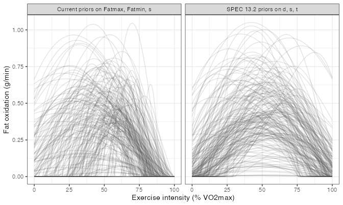
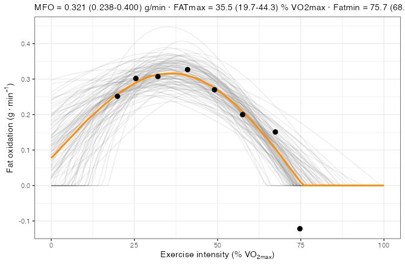
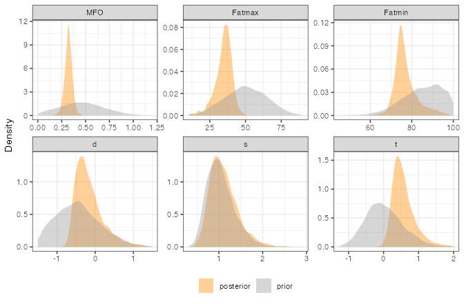
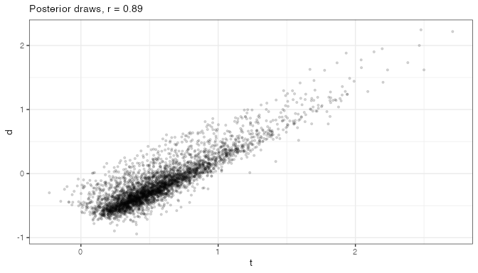

```{r, include = FALSE}
knitr::opts_chunk$set(collapse = TRUE, comment = "#>", eval = FALSE)
```

`MFO_bayes()` fits the SIN model of Chenevière et al. (2009) to the steps of
an MFO test as a Bayesian model (brms on Stan) and returns posterior medians
and credible intervals for MFO, Fatmax, Fatmin, the Fatmax zone and the SIN
parameters (SPEC 13.2). It does not replace `MFO()`; it is a separate
analysis of the steps that `MFO()` returns. brms and rstan are suggested
packages, and each model takes about a minute to compile, so the results
in this article were computed once with `inst/validation/bayes_vignette.R`
and are shown here as figures and printed output.

## The model and its parametrisation

Fat oxidation of step *i* is Normal(M sin(u~i~^s^), sigma), with
u = pi^1/s^ / (pi + 2d) (K x + d + t), K = pi / 100, x in %VO2max, and M the
MFO in g/min, so there is no normalisation by the highest step. Outside the
two zeros of the curve u^s^ is clamped to 0 or pi, so fat oxidation is 0
there.

The model is **parametrised by MFO, Fatmax, Fatmin and s**, the quantities
the data inform, and d and t are computed in each draw from the closed forms
of Fatmax and Fatmin (SPEC 6.5), with a = 2^-1/s^:

- t = pi + d - K Fatmin
- d = [pi (1 - a) + K (Fatmax - Fatmin)] / [2 (a - 1)]

Default priors, the authors' weakly informative choices:

- MFO ~ Normal(0.45, 0.25) truncated at 0, centred above the normative mean
  of sedentary adults (0.34 ± 0.10 g/min; Amaro-Gahete et al. 2018) with an
  inflated SD to cover trained people;
- Fatmax ~ Normal(50, 15) truncated to (10, 90) %VO2max, between the
  normative value of sedentary adults (44.2 ± 12.4; Amaro-Gahete et al.
  2018) and that of trained men (64 %; Achten et al. 2002);
- Fatmin ~ Normal(90, 14) truncated to (Fatmax, 100) %VO2max (90.1 ± 14.1
  in Chenevière et al. 2009);
- s ~ LogNormal(0, 0.3); sigma ~ Exponential(10).

## Why not priors on d, s and t

The first version of SPEC 13.2 put the priors on the SIN parameters:
d ~ Normal(0, 0.3), s ~ LogNormal(0, 0.3), t ~ Normal(0, 0.2). These priors
are centred on the basic SIN curve (d = 0, s = 1, t = 0: symmetric, with
its maximum at 50 %VO2max). A trained-like curve with Fatmax at 30-45
%VO2max needs t between 0.63 and 1.10, 3 to 5.5 SD above the prior mean.
Because s and t are strongly correlated in the posterior, the data fix the
shape of the curve but not where the parameters sit along that ridge, and
the prior decides it. In the simulation study below, in the population where
t is far from 0, the 95 % intervals of s with those priors contained the
true s in only **7-10 %** of tests, and those of Fatmin in 78-79 %.

## Prior predictive check

`MFO_prior_check()` samples the priors only (`sample_prior = "only"` in
brms) and draws the curves they imply.

```{r}
library(MFO)
data(list = c("basal_df", "MFO_df", "VO2max_df"))
r <- MFO(step_time = 20, db_MFO = MFO_df, db_basal = basal_df,
         db_graded = VO2max_df, cv_var = "RER", author = "Frayn",
         energy_equivalents = "classic", age = 30, negative_FAT = "keep")
pc <- MFO_prior_check(r$MFO_db, ndraws = 200, seed = 2)
plot(pc)
```

```{r, echo = FALSE, eval = TRUE, out.width = "100%", fig.alt = "200 fat oxidation curves drawn from the priors: on the left the SPEC 13.2 priors on d, s and t, concentrated around a symmetric curve with its maximum at 50 %VO2max and zeros near 100 %; on the right the current priors on Fatmax, Fatmin and s, with maxima spread over 25-70 %VO2max and zeros below 100 %."}

```

Both priors allow Fatmax over a similar range (5th-95th percentile 26.5-69.5
%VO2max with the SPEC priors, 24.7-70.9 with the current ones). They differ
in Fatmin: the SPEC priors put its median at 100.6 %VO2max (79.1-122.9), so
most of their curves reach zero beyond the maximal test; the current priors
keep it below 100 (median 85.3, 69.4-97.4), as observed.

## Fitting the example data

```{r}
b <- MFO_bayes(r$MFO_db, seed = 1)
b
plot(b)
```

```
<MFO_bayes> SIN model, sigma constant, 95 % credible intervals
   quantity median  lower  upper contraction            note
        MFO  0.321  0.238  0.400      0.9690
     Fatmax 35.500 19.700 44.300      0.8340
     Fatmin 75.700 68.600 92.100      0.6700
 zone_lower 24.000  1.500 33.800          NA
 zone_upper 47.200 36.900 55.100          NA
          d -0.236 -0.629  0.856      0.5980
          s  1.060  0.637  1.880      0.0151 prior-dominated
          t  0.508  0.119  1.470      0.6170
  max R-hat 1.006, min bulk ESS 951, min tail ESS 926, 0 divergent transition(s)
  largest posterior |r| among d, s and t: 0.89
  The shape parameters (d, s, t) are poorly identified among themselves; interpret MFO, Fatmax and Fatmin.
```

```{r, echo = FALSE, eval = TRUE, out.width = "100%", fig.alt = "Posterior fat oxidation curves of the example participant: 100 posterior draws in grey, the posterior median curve in orange and the observed steps as points."}

```

`contraction` = 1 - Var(posterior) / Var(prior) is how much the data
narrowed each quantity. MFO (0.97), Fatmax (0.83) and Fatmin (0.67) are
informed by the data; s is not (0.015, labelled `prior-dominated`).

## Prior and posterior

```{r, echo = FALSE, eval = TRUE, out.width = "100%", fig.alt = "Prior (grey) and posterior (orange) densities of MFO, Fatmax, Fatmin, d, s and t for the example participant: the posteriors of MFO, Fatmax and Fatmin are much narrower than their priors, while the posterior of s overlaps its prior."}

```

The posteriors of MFO, Fatmax and Fatmin are much narrower than their
priors. The posterior of s is its prior: the 8 steps say nothing about the
symmetry of the curve.

## The ridge

```{r, echo = FALSE, eval = TRUE, out.width = "80%", fig.alt = "Posterior draws of d against t for the example participant, forming a narrow diagonal band with correlation 0.89."}

```

The shape parameters are poorly identified among themselves: in this fit d
and t are correlated 0.89, and in simulated tests the largest correlation
among d, s and t was usually above 0.9. Many combinations of d, s and t draw
almost the same curve, and the prior decides where along that ridge the
posterior sits. This is a property of the SIN model, not of the priors, so
`print()` always gives the largest correlation with a fixed note:
**interpret MFO, Fatmax and Fatmin, not d, s and t**.

## Constant or proportional error

The errors of fat oxidation grow with intensity (fat oxidation is about
1.67 (VO2 - VCO2), which amplifies the error of VCO2). `sigma =
"proportional"` lets sigma grow linearly with %VO2max. Leave-one-out
cross-validation (`brms::loo()`) on the example data:

| sigma | elpd_loo | SE | elpd difference (SE) |
|---|---|---|---|
| proportional | 10.6 | 4.5 | 0 |
| constant | 7.4 | 3.9 | -3.2 (1.0) |

This comparison is an illustration of how to choose between them, not a
conclusion: it is one participant with 8 steps, and one or two observations
had a Pareto k above 0.7, so `loo()` is approximate here. The default stays
`"constant"`; compare both with `loo()` on your own data.

## Validation

Reduced study (Jorge, 2026-11-18): 100 simulated tests per cell, 8 steps,
noise on fat oxidation of 5 or 10 % of MFO (SD), MFO 0.4 g/min, in two
populations: "sedentary" (Fatmax 45 ± 8 %VO2max, with the shape d = 0.18,
s = 1.52, so Fatmin about 86) and "trained", defined by its Fatmax and
Fatmin: Fatmax 64 ± 8 %VO2max (Achten et al. 2002) and Fatmin 25 points
above it, about 89 (s = 1.52, d set to give that width).
Three options: the priors first proposed in SPEC 13.2 on d, s, t; t replaced
by Fatmax (prior N(44.2, 12.4)); and the current Fatmax + Fatmin. Coverage of
the 95 % credible intervals; median contraction of d and largest posterior
|r| among d, s, t; tests with divergent transitions or R-hat above 1.01
(adapt_delta = 0.99).

| Population | Noise | Option | MFO | Fatmax | Fatmin | d | s | Contraction d | max \|r\| | Divergences | R-hat > 1.01 |
|---|---|---|---|---|---|---|---|---|---|---|---|
| sedentary | 5 % | SPEC d, s, t | 0.96 | 0.85 | 0.79 | 0.56 | 0.07 | 0.81 | 0.92 | 0 | 0 |
| sedentary | 5 % | t by Fatmax | 0.97 | 0.89 | 0.94 | 0.97 | 0.92 | 0.67 | 0.96 | 2 | 1 |
| sedentary | 5 % | Fatmax + Fatmin | 0.96 | 0.88 | 0.93 | 0.97 | 0.97 | 0.85 | 0.96 | 0 | 0 |
| sedentary | 10 % | SPEC d, s, t | 0.99 | 0.94 | 0.78 | 0.81 | 0.10 | 0.64 | 0.81 | 2 | 0 |
| sedentary | 10 % | t by Fatmax | 0.99 | 0.96 | 0.93 | 1.00 | 0.89 | 0.52 | 0.90 | 7 | 1 |
| sedentary | 10 % | Fatmax + Fatmin | 0.99 | 0.94 | 0.91 | 0.98 | 0.99 | 0.74 | 0.92 | 3 | 0 |
| trained | 5 % | SPEC d, s, t | 0.95 | 0.96 | 0.98 | 0.92 | 0.99 | 0.88 | 0.92 | 0 | 7 |
| trained | 5 % | t by Fatmax | 0.93 | 0.96 | 0.88 | 0.92 | 0.90 | 0.74 | 0.90 | 1 | 8 |
| trained | 5 % | Fatmax + Fatmin | 0.93 | 0.97 | 0.98 | 0.99 | 0.94 | 0.99 | 0.94 | 0 | 5 |
| trained | 10 % | SPEC d, s, t | 1.00 | 0.98 | 0.91 | 0.93 | 0.96 | 0.61 | 0.82 | 0 | 4 |
| trained | 10 % | t by Fatmax | 0.99 | 0.98 | 0.86 | 0.90 | 0.90 | 0.49 | 0.84 | 12 | 2 |
| trained | 10 % | Fatmax + Fatmin | 0.99 | 0.88 | 0.92 | 0.95 | 0.91 | 0.96 | 0.87 | 1 | 1 |

The SPEC priors fail where t is far from 0 (the sedentary population with a
trained-like shape): the intervals of s covered the true s in 7-10 % of
tests. Fatmax + Fatmin keeps d, s and Fatmin at 0.91-0.99 in both
populations. Fatmax is short of 95 % in some cells (0.88), and its misses
have a direction: in the sedentary population every miss, in all three
options, was an underestimate (median error of the posterior median -1.1 to
-1.8 %VO2max), and so were the 12 misses of Fatmax + Fatmin in the trained
population at 10 % noise. The prior of s, centred on a symmetric curve (s = 1) while the
simulated curves have s = 1.52, explains part of it: with s ~ LogNormal(0,
0.5) or (0, 0.6) the median error fell from -1.15 to -0.74 and -0.45
%VO2max (sedentary, 5 %) and from -1.58 to -0.87 and -0.72 (trained, 10 %),
and coverage rose to 0.93-0.94 and 0.91, but the misses were still nearly
all underestimates and divergences increased. With s ~ LogNormal(0, 0.5)
and 4000 iterations, 9 % (sedentary) and 14 % (trained) of the fits still
had divergent transitions, so the default prior stays LogNormal(0, 0.3)
(`inst/validation/bayes_s_prior.R`).

**Limitation.** With the default priors, Fatmax is slightly underestimated:
by a median of 1.1-1.6 %VO2max in these simulations. For scale, the typical
error of Fatmax with the classical fits of the same kind of tests (8 steps)
was 1.6 (5 % noise) and 2.6 %VO2max (10 %) for the absolute SIN of
`MFO_kinetics()` (median absolute error) and 2.5-3.1 and 4.1-5.0 %VO2max for P3
(RMSE; `vignette("validation")`): the bias is smaller than the error of a
single test, but it is systematic. In the trained population 1-8 of 100
tests had an R-hat above 1.01 with every option; with `iter = 4000` none
did, so use `iter = 4000` when Fatmax is high.

## Reproducing

```
Rscript -e "devtools::load_all(); source('inst/validation/bayes_vignette.R')"
Rscript -e "devtools::load_all(); source('inst/validation/bayes_study.R')"
```

## References

Achten J, Gleeson M, Jeukendrup AE (2002). Med Sci Sports Exerc 34: 92-97.
doi:10.1097/00005768-200201000-00015

Amaro-Gahete FJ, Sanchez-Delgado G, Ruiz JR (2018). Front Physiol 9: 1460.
doi:10.3389/fphys.2018.01460

Bürkner PC (2017). brms: an R package for Bayesian multilevel models using
Stan. J Stat Softw 80(1): 1-28. doi:10.18637/jss.v080.i01

Carpenter B, et al. (2017). Stan: a probabilistic programming language. J
Stat Softw 76(1): 1-32. doi:10.18637/jss.v076.i01

Chenevière X, Malatesta D, Peters EM, Borrani F (2009). Med Sci Sports
Exerc 41: 1615-1625. doi:10.1249/MSS.0b013e31819e2f91
